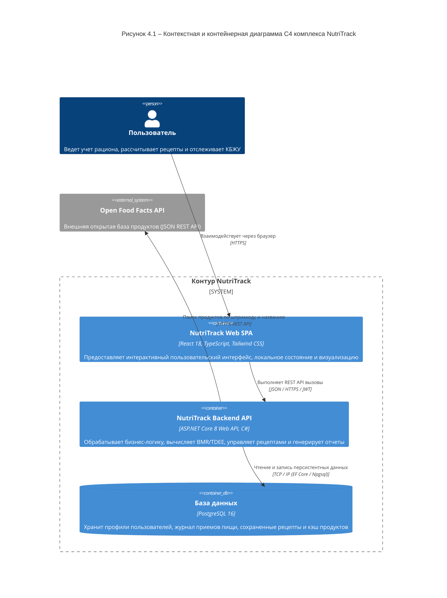
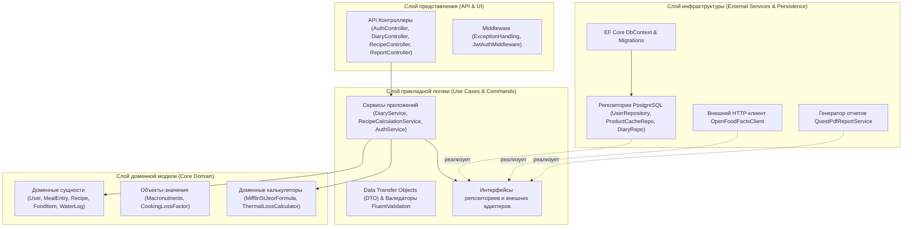
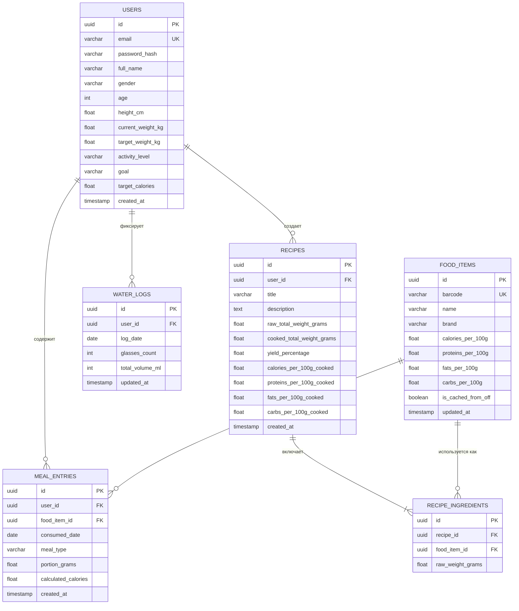
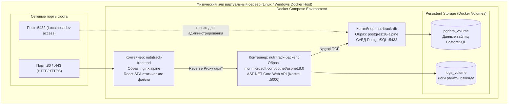

# Министерство образования Республики Беларусь
### Учреждение образования «Белорусский государственный университет информатики и радиоэлектроники»
**Факультет компьютерных систем и сетей**  
**Кафедра электронных вычислительных машин**  
**Дисциплина:** «Жизненный цикл разработки программного обеспечения»  

<br/><br/><br/>

# О Т Ч Ё Т
### к лабораторной работе № 4
### на тему: «РАЗРАБОТКА И ДОКУМЕНТИРОВАНИЕ СИСТЕМНЫХ ТРЕБОВАНИЙ»
**Вариант № 4**

<br/><br/><br/><br/>

**Студент:** Буринский Н. А., группа 450504  
**Преподаватель:** Внук О. М.  

<br/><br/><br/>

**Минск 2026**

---

## 1 ЦЕЛЬ РАБОТЫ

Целями настоящей лабораторной работы являются:
1. Освоение методологии системного анализа, идентификации, формализации и документирования системных требований к программному обеспечению на базе ранее утвержденной спецификации бизнес-требований (SRS).
2. Приобретение практических навыков разработки нормативной архитектурной документации по международным стандартам IEEE 1016-2009 и ISO/IEC/IEEE 42010 в формате описания дизайна программного обеспечения (Software Design Description, SDD).
3. Изучение и применение методологии протоколирования архитектурных решений (Architectural Decision Records, ADR) для фиксации ключевых технологических развилок.
4. Освоение методик инженерной декомпозиции задач, оценки трудоемкости в человеко-часах, календарного планирования и управления рисками в условиях жестких ресурсных ограничений (дедлайн, бюджет, размер команды).
5. Развитие практических компетенций ведения профессиональных переговоров с Заказчиком при обработке запросов на изменение (Change Requests) и оптимизации критического пути проекта.

---

## 2 ЗАДАЧИ

Для достижения поставленной цели необходимо решить следующий комплекс взаимосвязанных аналитических, архитектурных и управленческих задач:
1. Изучить теоретические основы и стандарты документирования системных требований (IEEE 1016, ISO/IEC/IEEE 42010, IEEE 29148).
2. На основе утвержденного в лабораторной работе № 3 документа SRS сквозного проекта «NutriTrack» идентифицировать полный спектр системных функциональных и нефункциональных требований.
3. Провести ранжирование приоритетов разрабатываемой функциональности по нормативной шкале от 10 (Highest) до 50 (Lowest) с англоязычной кодификацией.
4. Разработать системный архитектурный документ `sdd/sdd-nutritrack.md` с описанием проектных представлений:
   - контекстное и контейнерное представление (Context & Container C4);
   - логическое представление и структура слоев Clean Architecture;
   - информационная реляционная модель базы данных (ER-диаграмма);
   - представление динамического взаимодействия (Sequence-диаграмма гибридного кэширования API);
   - алгоритмическое представление математической модели термической уварки блюд;
   - физическое представление и архитектура контейнеризованного развертывания (Docker Compose).
5. Разработать и задокументировать комплект из 4 протоколов архитектурных решений (ADR) по ключевым развилкам проекта:
   - ADR-0001: Выбор архитектурного стиля модульного монолита и Clean Architecture;
   - ADR-0002: Стратегия двухуровневого кэширования Open Food Facts API;
   - ADR-0003: Модель расчета нутриентов при термической обработке рецептов;
   - ADR-0004: Выбор серверного движка QuestPDF для генерации отчетов.
6. Смоделировать и задокументировать первый раунд переписки с Заказчиком: выполнить инженерную оценку трудоемкости функционала, защитить сроки перед Заказчиком, обосновать необходимость сложных подсистем и сформировать базовый итерационный план (3 спринта по 2 недели, 240 чел-ч, бюджет $8 400).
7. Смоделировать и задокументировать второй раунд переговоров с Заказчиком: проанализировать внезапный запрос на изменение (добавление модуля еженедельных аналитических отчетов в PDF/Excel), отработать категорический отказ Заказчика сдвигать дедлайн (6 недель) и переплачивать за переработки, выдвинуть решение с привлечением Junior-разработчика ($15/ч), провести перерасчет расписания и стоимости ($9 150) и утвердить итоговый согласованный план.
8. Сформулировать развернутые аргументированные ответы на 6 контрольных вопросов.
9. Зафиксировать историю проекта в системе контроля версий Git (ветка `lab4` репозитория SDLC) и синхронизировать наработки с удаленным репозиторием на GitHub.

---

## 3 ОПИСАНИЕ ЗАДАНИЯ И ВЫБРАННЫЙ ПРОЕКТ

В рамках сквозного курсового цикла по дисциплине «Жизненный цикл разработки ПО» продолжается проектирование и документирование программного комплекса по варианту № 4 — **«NutriTrack» (Персонализированный трекер-калькулятор питания)**.

### Архитектурные характеристики и технологический стек проекта:
- **Название системы:** «NutriTrack» (Cross-Platform Nutrition Tracker & Recipe Calculator);
- **Назначение:** автоматизация учета пищевого рациона, расчет метаболического расхода (BMR/TDEE) по формуле Миффлина — Сан Жеора, мониторинг макронутриентов (КБЖУ) и гидробаланса;
- **Архитектурный тип:** трехуровневое клиент-серверное веб-приложение (Single Page Application + RESTful Web API);
- **Серверная платформа (Backend):** C#, платформа .NET 8 / ASP.NET Core Web API, реализующая принципы модульного монолита и Clean Architecture;
- **Клиентская платформа (Frontend):** TypeScript, библиотека React 18, сборщик Vite, адаптивная стилизация Tailwind CSS;
- **СУБД (Persistence Layer):** реляционная база данных PostgreSQL 16 с ORM Entity Framework Core;
- **Интеграционный слой:** взаимодействие с открытым международным REST API Open Food Facts через защищенный HTTP-клиент с двухуровневым кэшированием (L1 In-Memory + L2 PostgreSQL);
- **Подсистема формирования отчетности:** кроссплатформенный серверный движок QuestPDF (на базе SkiaSharp) для рендеринга аналитических PDF-документов и OpenXML для выгрузки в Excel;
- **Инфраструктура развертывания:** контейнеризованный контур Docker Compose (Nginx + ASP.NET Core Kestrel + PostgreSQL);
- **Бизнес-изюминка (Killer Feature):** математический модуль расчета составных кулинарных рецептов с автоматическим учетом физического коэффициента термической обработки (уварки круп и овощей, ужарки мяса и рыбы) с точным расчетом итоговой удельной энергетической ценности на 100 г готового блюда.

---

## 4 ЭТАПЫ РАБОТЫ

### 4.1 Идентификация и спецификация системных требований

На основе бизнес-требований из SRS v1.0 архитектором системы были сформулированы функциональные и нефункциональные системные требования. Каждому требованию присвоен уникальный идентификатор и ранг приоритета в соответствии со шкалой **10–50** на английском языке (где 10 — наивысший критический приоритет, 50 — минимальный отложенный).

Таблица 4.1 – Реестр системных требований с ранжированием приоритетов (Priority 10–50)

| Идентификатор | Модуль | Системное требование | Трассировка к SRS | Priority |
| :--- | :--- | :--- | :--- | :---: |
| **SYS-REQ-001** | Nutrition Engine | Расчет суточных норм BMR/TDEE по формуле Миффлина — Сан Жеора с динамической калькуляцией целевого баланса КБЖУ в зависимости от выбранного дефицита/профицита калорий. | REQ-FUNC-001 | **10** (Highest) |
| **SYS-REQ-002** | Diary Management | Ведение суточного журнала приемов пищи (Завтрак, Обед, Ужин, Перекус), добавление порций, автоматическое суммирование КБЖУ дня с визуализацией прогресс-баров. | REQ-FUNC-002 | **10** (Highest) |
| **SYS-REQ-003** | Recipe Thermal Engine | Моделирование кулинарных рецептов: учет исходных сырых ингредиентов, фактической массы готового блюда и автоматический пересчет удельного КБЖУ на 100 г готовой продукции («изюминка»). | REQ-FUNC-003 | **20** (High) |
| **SYS-REQ-004** | OFF Integration & Cache | Поиск продуктов в каталоге Open Food Facts API по штрихкоду/названию с локальной персистентной репликацией в СУБД PostgreSQL и L1 in-memory кэшированием. | REQ-FUNC-004 | **30** (Medium) |
| **SYS-REQ-005** | Hydration Tracker | Учет потребления воды с шагом 250 мл, автоматический расчет суточной гидратационной нормы (30 мл/кг) и визуализация статуса гидробаланса. | REQ-FUNC-005 | **40** (Low) |
| **SYS-REQ-006** | Reporting & Export | Генерация структурированных еженедельных аналитических отчетов по динамике нутриентов и веса с экспортом в векторный PDF (QuestPDF) и Excel (OpenXML). | Запрос Заказчика (Раунд 2) | **30** (Medium) |
| **SYS-NFR-SEC** | Безопасность | Хранение паролей через BCrypt (cost factor >= 11), передача данных исключительно по TLS 1.3/HTTPS, авторизация REST API через Stateless JWT. | REQ-SEC-001 | **10** (Highest) |
| **SYS-NFR-PERF** | Производительность | Время формирования ответа бэкенда на типовые запросы чтения журнала и поиска в локальном кэше продуктов не должно превышать 200 мс при 50 одновременных пользователях. | REQ-PERF-001 | **20** (High) |
| **SYS-NFR-REL** | Надежность | Сохранение непрерывности работы интерфейса при недоступности внешнего API Open Food Facts (Graceful Degradation / Fallback на локальный кэш). | REQ-REL-001 | **30** (Medium) |
| **SYS-NFR-PORT** | Переносимость | Полная контейнеризация всех компонентов сервиса в Docker Compose. | REQ-PORT-001 | **30** (Medium) |

---

### 4.2 Проектирование архитектурного документа SDD и проектные представления

В соответствии со стандартом IEEE 1016-2009 разработан нормативный архитектурный документ `sdd/sdd-nutritrack.md`. Ниже приведены основные архитектурные представления системы.

#### 4.2.1 Контекстное и контейнерное представление (Context & Container C4)
На рисунке 4.1 представлена контекстная и контейнерная диаграмма C4, отражающая границы системы, роли пользователей, внутренние контейнеры и протоколы интеграции с внешним миром.



#### 4.2.2 Логическое представление: Модульная Чистая Архитектура (Clean Architecture)
На рисунке 4.2 приведена диаграмма слоев программной системы. Архитектура гарантирует полную независимость доменного ядра от фреймворков, СУБД и внешних провайдеров.


Рисунок 4.2 – Организация слоев Clean Architecture в серверной части NutriTrack

#### 4.2.3 Информационное представление: Реляционная схема базы данных (ERD)
На рисунке 4.3 приведена схема реляционной базы данных PostgreSQL в нотации «Воронья лапка» (Crow's Foot). Модель нормализована до 3-й нормальной формы.


Рисунок 4.3 – Реляционная модель данных (ERD) системы NutriTrack

#### 4.2.4 Представление взаимодействия: Процесс поиска и кэширования продуктов
На рисунке 4.4 приведена диаграмма последовательности (Sequence Diagram), иллюстрирующая работу гибридного кэша (L1 MemoryCache + L2 PostgreSQL + L3 Open Food Facts API) с обработкой сбоев внешней сети.

```mermaid
sequenceDiagram
    autonumber
    actor User as Клиент (React SPA)
    participant API as ASP.NET Core API
    participant Cache as L1 In-Memory Cache
    participant DB as L2 PostgreSQL (FoodItems)
    participant OFF as L3 Open Food Facts API

    User->>API: GET /api/products/search?query=молоко
    API->>Cache: Проверка наличия ключа query в RAM
    alt Кэш L1 содержит результат (Cache Hit)
        Cache-->>API: Возврат списка продуктов
        API-->>User: HTTP 200 OK (быстрый ответ < 10 мс)
    else Промах в L1 (Cache Miss)
        API->>DB: Поиск в таблице FoodItems (ilike %query%)
        alt Найдены записи в БД L2 (DB Hit)
            DB-->>API: Возврат сохраненных продуктов
            API->>Cache: Сохранение выборки в L1 (TTL = 30 мин)
            API-->>User: HTTP 200 OK (ответ < 50 мс)
        else Записи в локальной БД отсутствуют (Full Miss)
            API->>OFF: HTTPS GET /cgi/search.pl?search_terms=молоко&json=1
            alt Успешный ответ от внешнего сервиса
                OFF-->>API: Массив данных продуктов в JSON
                API->>DB: Сохранение продуктов в FoodItems (is_cached=true)
                API->>Cache: Запись в память L1
                API-->>User: HTTP 200 OK (ответ ~ 250-400 мс)
            else Сбой / Таймаут внешнего сервиса Open Food Facts
                OFF-->>API: Ошибка 504 Gateway Timeout / Network Error
                API-->>User: Возврат локальных совпадений + Warning флаг (Graceful Fallback)
            end
        end
    end
```
Рисунок 4.4 – Диаграмма последовательности поиска продуктов с гибридным кэшированием

#### 4.2.5 Алгоритмическое представление: Математический расчет уварки/ужарки блюд
В отличие от тривиальных калькуляторов, модуль расчета рецептов NutriTrack базируется на строгом физическом законе сохранения массы питательных веществ. 

Для набора сырых ингредиентов $\{I_1, \dots, I_n\}$ с массами $m_k$ и содержанием нутриентов $c_k$ на 100 г вычисляется суммарная абсолютная калорийность:
$$E_{total} = \sum_{k=1}^n \left( \frac{m_k \cdot c_k}{100} \right)$$

После приготовления пользователь взвешивает блюдо и указывает фактический вес $M_{cooked}$. Итоговая энергетическая ценность на 100 г готового блюда рассчитывается по формуле:
$$C_{100g} = \left( \frac{E_{total}}{M_{cooked}} \right) \cdot 100$$

Формула абсолютно инвариантна к кулинарному процессу: при разваривании круп ($M_{cooked} > M_{raw}$) удельная калорийность снижается; при ужарке мяса ($M_{cooked} < M_{raw}$) удельная калорийность возрастает.

#### 4.2.6 Физическое представление и контейнеризация (Deployment View)
На рисунке 4.5 представлена схема развертывания системы в изолированной виртуальной сети Docker.


Рисунок 4.5 – Архитектура контейнеризованного развертывания комплекса NutriTrack

---

### 4.3 Формализация архитектурных решений (ADR)

Для исключения архитектурной эрозии ключевые инженерные выборы зафиксированы в стандартизированных документах ADR (каталог `adr/`):
1. **ADR-0001: Выбор архитектурного стиля модульного монолита и Clean Architecture**. Выбран модульный монолит вместо микросервисов. Обоснование: при размере команды 1–2 человека и 6-недельном сроке микросервисы создают критические инфраструктурные риски. Чистая слоистая архитектура изолирует расчетные ядра BMR и уварки в слое Domain, обеспечивая 100% покрытие юнит-тестами.
2. **ADR-0002: Стратегия двухуровневого кэширования Open Food Facts API**. Выбрано гибридное кэширование L1 In-Memory (`IMemoryCache`) + L2 PostgreSQL (`FoodItems`). Это устраняет риск блокировок по rate-limit стороннего сервиса и сокращает время отклика поиска до < 25 мс для 90%+ запросов.
3. **ADR-0003: Модель расчета нутриентов при термической обработке рецептов**. Выбрана модель пересчета через чистую готовую массу (Net Yield Weight Calculation) вместо неточных справочных таблиц ГОСТ.
4. **ADR-0004: Выбор серверного движка QuestPDF для генерации отчетов**. Выбрана C#-библиотека QuestPDF на базе SkiaSharp. Решение обеспечивает рендеринг векторных 10-страничных отчетов за ~200 мс без необходимости развертывания тяжелых браузерных движков (Puppeteer/Chromium) в Docker.

---

### 4.4 Первый раунд переговоров с Заказчиком и базовый итерационный план

В соответствии с ролевой моделью выполнения работы («Архитектор — Заказчик») был проведен первый раунд согласования сроков и трудоемкости. 

Заказчик выразил обеспокоенность совокупным объемом работ (первоначальная оценка 250 часов, $8 750) и усомнился в необходимости тратить 45 часов на Open Food Facts и 40 часов на калькулятор уварки при ограниченном бюджете $8 500.

Архитектор провел техническую аргументацию:
- продемонстрировал риски падения и блокировок внешнего API Open Food Facts без подсистемы кэширования;
- раскрыл состав работ по калькулятору рецептов (динамический UI, валидация полярных сценариев усадки/разбухания, связывание с дневником).

В результате конструктивного диалога был достигнут компромисс: оптимизированы второстепенные задачи и сформирован **Базовый итерационный план** ровно на 240 часов и бюджет $8 400 (таблица 4.2).

Таблица 4.2 – Базовый итерационный план разработки комплекса NutriTrack (3 спринта)

| Итерация | Сроки | Состав модулей и задач | Приоритеты | Часы | Стоимость ($) |
| :--- | :---: | :--- | :---: | :---: | :---: |
| **Итерация 1** *(Фундамент)* | Недели 1–2 | Docker, БД PostgreSQL, JWT-авторизация, профиль, расчет BMR/TDEE, дневник питания (CRUD, дашборд). | 10 (Highest) | 80 | $2 800 |
| **Итерация 2** *(Интеграция)* | Недели 3–4 | Локальная БД продуктов, L1-кэш, интеграционный клиент Open Food Facts, поисковый UI. | 30 (Medium)<br/>20 (High) | 80 | $2 800 |
| **Итерация 3** *(Релиз MVP)* | Недели 5–6 | Калькулятор термообработки (уварка), сохранение блюд, трекер воды, интеграционное тестирование, сдача. | 20 (High)<br/>40 (Low) | 80 | $2 800 |
| **ИТОГО** | **6 недель** | **Полный базовый объем MVP (1 Senior, $35/час)** | — | **240** | **$8 400** |

---

### 4.5 Второй раунд переговоров, защита дедлайна и привлечение Junior-разработчика

На предрелизной стадии Заказчик выдвинул экстренный запрос на изменение (Change Request): добавить **модуль формирования еженедельных аналитических отчетов в PDF и Excel** (SYS-REQ-006). Анализ показал, что данная функция требует **50 дополнительных человеко-часов**.

Прямая реализация силами Архитектора привела бы к нарушению дедлайна (+1.5 недели) и превышению бюджета (+ $1 750). Заказчик категорически отверг сдвиг дедлайна ввиду жестко зафиксированной даты маркетинговой кампании и отказался переплачивать $1 750.

Архитектор предложил управленческое решение: **привлечь к проекту Junior-разработчика** со ставкой **$15/час**. 

Задачи были распределены:
- Архитектор (Буринский Н. А.) спроектировал архитектуру, создал контракты интерфейсов и оставил за собой ядро системы и код-ревью;
- Junior-разработчику были поручены изолированные задачи: верстка шаблонов QuestPDF, генерация Excel-файлов и верстка виджета воды (суммарно 50 часов).

Благодаря параллелизации работ **срок 6 недель был полностью сохранен**, а суммарные затраты на добавленную фичу составили всего **$750** (50 ч × $15) вместо $1 750. Обновленный согласованный план представлен в таблице 4.3.

Таблица 4.3 – Скорректированный и согласованный план с участием Junior-разработчика

| Итерация | Недели | Задачи Senior / Архитектора ($35/ч) | Задачи Junior разработчика ($15/ч) | Часы спринта | Бюджет спринта |
| :--- | :---: | :--- | :--- | :---: | :---: |
| **Итерация 1** | 1–2 | Каркас, БД, JWT, расчет BMR/TDEE, дневник питания. | *Не привлекается* | 80 ч (Senior) | **$2 800** |
| **Итерация 2** | 3–4 | Кэш L1/L2, Open Food Facts, агрегация аналитики для отчетов, код-ревью Junior. | Верстка шаблона отчета в QuestPDF, экспорт таблиц в Excel. | 80 ч (Senior)<br/>+ 25 ч (Junior) | $2 800 + $375 =<br/>**$3 175** |
| **Итерация 3** | 5–6 | Калькулятор уварки/ужарки, связка с дневником, интеграционные тесты, релиз. | UI диалога экспорта отчетов, верстка виджета гидратации. | 80 ч (Senior)<br/>+ 25 ч (Junior) | $2 800 + $375 =<br/>**$3 175** |
| **ИТОГО** | **6 нед.** | **240 часов Senior ($8 400)** | **50 часов Junior ($750)** | **290 часов** | **$9 150** |

---

## 5 ОТВЕТЫ НА КОНТРОЛЬНЫЕ ВОПРОСЫ

### Вопрос 1. Что делать, если планируемое время на реализацию определенных функций много больше длины итерации: как планировать и как показывать заказчику?

**Ответ.** Ситуация, когда трудоемкость функции превышает продолжительность одной итерации (спринта), является классическим вызовом итеративной разработки. Реализация такой функции «целиком в закрытую» нарушает ключевой принцип Agile — регулярную поставку работающего инкремента ценности (Working Software).

Для решения проблемы применяются следующие подходы:
1. **Вертикальная декомпозиция (Vertical Slicing):** Функция разбивается не по техническим слоям («сначала напишем базу данных, в следующем спринте API, затем UI»), а по вертикальным пользовательским сценариям сквозной функциональности:
   - *Итерация N (Tracer Bullet / Walking Skeleton):* Реализация минимального сценария («Happy Path») со статическими допущениями (например, простой расчет по одному ингредиенту с выводом в консоль/базовый UI).
   - *Итерация N+1:* Добавление комплексной валидации, обработки граничных случаев (уварка, ужарка, выкипание) и сохранения в базу данных.
   - *Итерация N+2:* Интеграция с каталогом, доведение UX до идеала.
2. **Выделение исследовательского спайка (Architectural Spike):** Если оценка велика из-за технологической неопределенности (например, интеграция со сложной внешней системой), в план итерации включается строго ограниченный по времени «Spike» (Timeboxed задача на 8–16 часов) для проверки концепции (PoC). По итогам спайка неопределенность снимается, и оставшаяся работа разбивается на компактные задачи.
3. **Демонстрация заказчику:** Заказчику демонстрируется не незаконченный «черный ящик», а работающий функциональный срез на тестовом стенде. Архитектор показывает работающую базовую часть сценария, акцентирует внимание на прозрачности прогресса и демонстрирует Burndown Chart оставшегося объема задач.

---

### Вопрос 2. Что делать, когда заказчик во время разработки проекта захотел добавить новый функционал?

**Ответ.** Появление новых требований в процессе разработки — естественное проявление эволюции проекта. Однако хаотичное добавление задач «на лету» приводит к распаду архитектуры, срыву сроков и эмоциональному выгоранию команды («Scope Creep»).

Регламент работы с изменениями строится на следующих правилах:
1. **Оформление запроса на изменение (Change Request, CR):** Любое новое требование документируется: фиксируются бизнес-цель, критерии приемки и влияние на смежные подсистемы.
2. **Правило неизменяемости активного спринта (Sprint Goal Protection):** Если команда уже находится внутри зафиксированной итерации, новое требование **не берется в работу немедленно**. Текущий спринт защищен от вмешательств. Запрос направляется в бэклог продукта (Product Backlog).
3. **Оценка трудоемкости и анализ критического пути:** Архитектор оценивает трудоемкость нового функционала.
4. **Принцип торгового баланса («Trade-off» / Проектный треугольник):** Заказчику наглядно демонстрируется, что добавление объема $X$ требует компенсации:
   - *Вариант «Замена» (Scope Swap):* Заказчик выбирает из бэклога спринта задачи аналогичной трудоемкости с наименьшим приоритетом (Low/Nice to Have) и исключает их из текущей поставки. Срок и бюджет остаются неизменными.
   - *Вариант «Увеличение бюджета/срока»:* Новая функция сдвигает дату релиза или оплачивается дополнительно.
5. **Внесение изменений в документацию:** При утверждении запроса обновляются системные требования (SDD), расставляются приоритеты и корректируется матрица трассируемости.

---

### Вопрос 3. Что делать, когда заказчик захотел в конце разработки добавить новый важный функционал?

**Ответ.** Запрос на добавление важной функциональности на финальном этапе разработки (в предрелизном спринте или на этапе UAT-приемки) несет максимальные риски для стабильности системы, так как любое масштабное вмешательство в кодовую базу способно породить регрессионные дефекты.

Инженерно-управленческая стратегия в данной ситуации:
1. **Анализ критичности (Triage & MVP Validation):** Проводится жесткий анализ: действительно ли функция является блокирующей (Show-stopper), без которой запуск системы невозможен, либо это желание улучшить продукт («Gold Plating»). Если продукт решает основную бизнес-задачу без этой функции, заказчику аргументированно предлагается запланировать её в **Релиз 1.1 (первый пост-релизный патч)**.
2. **Анализ влияния на релизную дату (Hard Deadline Analysis):** Если дедлайн жесткий (привязаны маркетинговые обязательства, юридические соглашения), сдвиг даты невозможен.
3. **Применение паттерна параллелизации и расширения ресурсов:** Если функция действительно критична для бизнеса, а срок сдвигать нельзя, применяется подход, смоделированный во 2-м раунде настоящей работы:
   - Декомпозиция функции на ядровые и второстепенные задачи;
   - Привлечение дополнительных доступных ресурсов (например, Junior/Middle разработчиков) под руководством ведущего инженера;
   - Перераспределение рутинных задач для освобождения критического пути.
4. **Усиленное регрессионное тестирование:** Любой код, внедряемый в конце разработки, подлежит обязательному автоматизированному и смоук-тестированию, чтобы исключить поломку готовых модулей перед передачей в продакшн.

---

### Вопрос 4. Как используются ролевые игры и наблюдение для формирования списка требований?

**Ответ.** Ролевые игры и наблюдение являются мощными методами эмпирической инженерии требований, ориентированными на извлечение неявных знаний (Tacit Knowledge), которые пользователи часто не могут сформулировать в виде формального интервью.

1. **Ролевые игры (Role Playing / Persona Simulation):**
   - Участники команды разработки и бизнес-аналитики принимают на себя роли различных персонажей (персон) целевой аудитории. Например, в проекте «NutriTrack» моделировались роли: «Спортсмен в период сушки», «Офисный работник с дефицитом времени», «Кулинарный блогер, взвешивающий сложные блюда».
   - Разыгрываются реальные пользовательские сценарии от начала до конца: выбор продукта в магазине, попытка быстро занести в дневник порцию супа за обедом на ходу.
   - *Эффект:* Моментально вскрываются скрытые барьеры и боли: осознается, что вводить граммы сырых ингредиентов для готового супа невозможно (так родилось требование калькулятора уварки SYS-REQ-003); становится понятно, что при плохом мобильном интернете медленный поиск неприемлем (родилось требование локального кэша SYS-REQ-004).
2. **Наблюдение (Field Observation / Shadowing):**
   - Аналитик находится непосредственно в среде пользователя («в поле») и наблюдает за его реальными действиями без вмешательства в процесс.
   - Фиксируются реальные привычки, отвлекающие факторы, количество кликов, повторяющиеся ошибки и обходные пути (workarounds), к которым прибегает человек (например, запись веса на стикерах).
   - *Эффект:* Позволяет отделить декларируемые потребности («я хочу сложную систему отчетов с сотней графиков») от фактических («мне нужна одна кнопка, чтобы переслать дневник тренеру в мессенджер»).

---

### Вопрос 5. Какие требования предъявляются к пользовательским историям?

**Ответ.** К качественным пользовательским историям (User Stories) в современной программной инженерии предъявляется международный комплекс требований, стандартизированный критериями **INVEST** (автор — Билл Уэйк), а также структурные требования к формулировке.

#### 1. Структурный формат формулировки:
История должна четко определять роль, действие и бизнес-ценность:  
> **«Как [роль пользователя], я хочу [выполнить действие], чтобы [получить измеримую бизнес-ценность / выгоду]».**

#### 2. Критерии качества INVEST:
- **I — Independent (Независимость):** История должна быть по возможности автономной, чтобы её можно было разрабатывать, тестировать и выпускать независимо от других историй в произвольном порядке.
- **N — Negotiable (Обсуждаемость):** История не является незыблемым контрактом с жестко фиксированными деталями кода; это повод для диалога между командой и Заказчиком.
- **V — Valuable (Ценность):** История должна нести понятную и осязаемую практическую ценность для конечного пользователя или бизнеса (чисто технические задачи типа «создать таблицу в БД» историями не являются).
- **E — Estimable (Оцениваемость):** Команда разработки должна обладать достаточным пониманием объема работ, чтобы оценить трудоемкость истории в Story Points или часах.
- **S — Small (Компактность):** История должна быть достаточно компактной, чтобы быть полностью завершенной в рамках одной итерации (спринта) без переноса остатков.
- **T — Testable (Тестируемость):** История должна иметь четкие критерии приемки (**Acceptance Criteria**), позволяющие однозначно верифицировать факт её корректного выполнения (часто формулируются по шаблону Given-When-Then).

---

### Вопрос 6. Как понять, что пора заканчивать собирать требования на текущий момент?

**Ответ.** Бесконечный сбор и уточнение требований — опасный антипаттерн («Аналитический паралич» / Analysis Paralysis), приводящий к откладыванию старта разработки и потере рыночных возможностей.

Момент завершения сбора требований на текущую фазу наступает при одновременном выполнении следующих критериев:
1. **Информационное насыщение (Diminishing Returns):** Каждое последующее интервью или опрос стейкхолдеров перестает приносить качественно новую информацию и лишь повторяет или незначительно варьирует ранее известные факты. Затраты на дальнейший сбор превышают ценность получаемых данных.
2. **Полнота покрытия ядра MVP (Core Scope Coverage):** Все ключевые бизнес-цели проекта (определенные в Vision & Scope) закрыты специфицированными функциональными требованиями с критериями приемки. Основной сценарий («Golden Path») пользователя полностью обеспечен требованиями.
3. **Разрешение архитектурных развилок:** Сняты фундаментальные технические риски и противоречия: выбран технологический стек, определены интерфейсы интеграции, зафиксированы ключевые ADR.
4. **Достаточность для старта спринта (Definition of Ready, DoR):** Требования верхнего эшелона бэклога (с приоритетами 10 и 20) декомпозированы, оценены командой разработки, не содержат внутренних противоречий и понятны исполнителям без двусмысленностей.
5. **Фиксация границ итерации (Timeboxing):** Наступил дедлайн фазы предварительного анализа (Inception Phase). Дальнейшие уточнения второстепенных требований переносятся в плановый процесс управления бэклогом (Backlog Refinement) последующих спринтов.

---

## ЗАКЛЮЧЕНИЕ

В ходе выполнения лабораторной работы № 4 были успешно исследованы и практически освоены современные методы разработки, структурирования и документирования системных требований к программному обеспечению.

### Основные практические и теоретические результаты:
1. На основе ранее согласованного SRS v1.0 сквозного проекта «NutriTrack» идентифицирован и формализован комплекс системных требований с кодификацией приоритетов по нормативной шкале **10–50** на английском языке (Highest — Lowest).
2. Разработан системный архитектурный документ **SDD (Software Design Description)** в строгом соответствии со стандартом IEEE 1016-2009. В документ включены фундаментальные проектные представления: C4 контекстная и контейнерная модели, Clean Architecture декомпозиция модулей бэкенда на C# / .NET 8, ER-диаграмма реляционной базы данных PostgreSQL, Sequence-диаграмма гибридного кэширования Open Food Facts API, алгоритмическая математическая модель уварки блюд и физическая схема развертывания в Docker Compose.
3. Разработан комплект из **4 протоколов архитектурных решений (ADR)**, обосновывающих выбор модульного монолита, стратегии многоуровневого кэширования, физической модели взвешивания готовых блюд и серверного движка QuestPDF.
4. Смоделирован переговорный процесс с Заказчиком в формате двух раундов деловой переписки:
   - В первом раунде аргументирована трудоемкость критических модулей, преодолены сомнения Заказчика и утвержден **базовый итерационный план на 240 человеко-часов ($8 400)** с разбивкой на 3 двухнедельных спринта.
   - Во втором раунде отработан критический запрос на изменение (добавление модуля аналитических отчетов в PDF/Excel, +50 часов). В условиях жесткого отказа Заказчика сдвигать дедлайн (6 недель) и переплачивать за овертаймы, выдвинуто эффективное инженерное решение по привлечению **Junior-разработчика ($15/час)** под архитектурным менторством Senior ($35/час). 
   - За счет параллелизации некритических задач срок в 6 недель был полностью сохранен, а итоговый бюджет скорректирован до компромиссных **$9 150** (экономия $1 000 относительно базовой ставки).
5. Подготовлены исчерпывающие профессиональные ответы на 6 контрольных вопросов по управлению изменениями, декомпозиции функций, критериям INVEST и завершению сбора требований.
6. Все артефакты систематизированы и зафиксированы в ветке `lab4` репозитория SDLC с последующей синхронизацией с GitHub.
