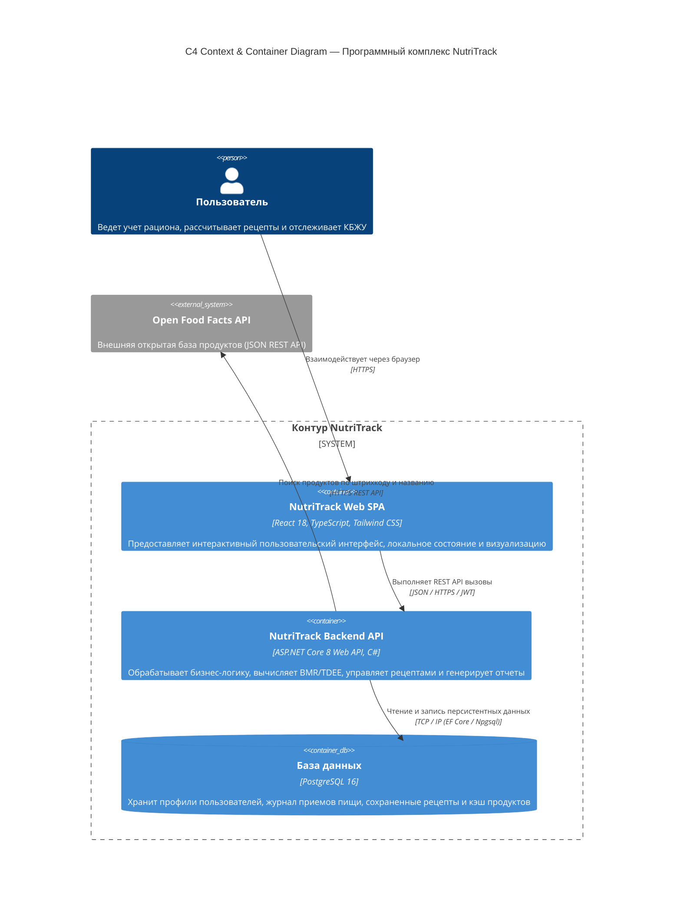
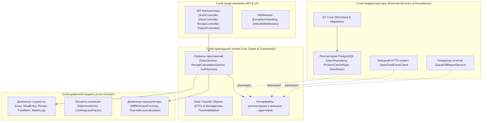
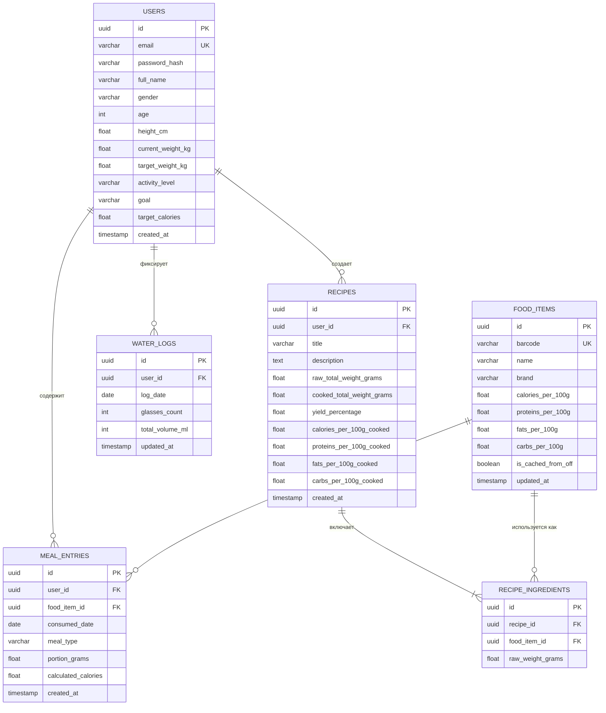
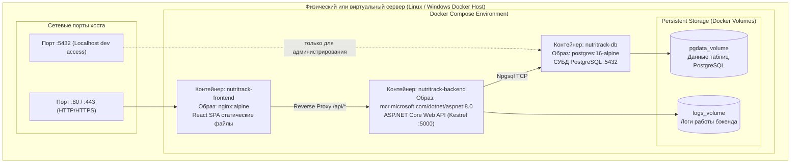

# Описание дизайна программного обеспечения (Software Design Description, SDD)

## Для программного комплекса «NutriTrack» (Трекер-калькулятор питания)

**Версия:** 1.0  
**Статус:** Согласовано  
**Автор:** Буринский Н. А. (студент гр. 450504)  
**Организация:** БГУИР, Факультет компьютерных систем и сетей, Кафедра ЭВМ  
**Дата изменения:** 19.11.2026  

---

## Оглавление

<!-- TOC -->
* [1. Введение](#1-введение)
  * [1.1 Назначение документа](#11-назначение-документа)
  * [1.2 Область применения](#12-область-применения)
  * [1.3 Определения, акронимы и сокращения](#13-определения-акронимы-и-сокращения)
  * [1.4 Ссылки](#14-ссылки)
  * [1.5 Обзор документа](#15-обзор-документа)
* [2. Обзор архитектурного дизайна](#2-обзор-архитектурного-дизайна)
  * [2.1 Задачи и интересы стейкхолдеров](#21-задачи-и-интересы-стейкхолдеров)
  * [2.2 Выбранные архитектурные точки зрения (Viewpoints)](#22-выбранные-архитектурные-точки-зрения-viewpoints)
* [3. Системные требования и ранжирование приоритетов](#3-системные-требования-и-ранжирование-приоритетов)
  * [3.1 Шкала приоритетов (System Priority Scale 10–50)](#31-шкала-приоритетов-system-priority-scale-1050)
  * [3.2 Спецификация функциональных системных требований](#32-спецификация-функциональных-системных-требований)
  * [3.3 Спецификация нефункциональных требований и атрибутов качества](#33-спецификация-нефункциональных-требований-и-атрибутов-качества)
* [4. Проектные архитектурные представления (Design Views)](#4-проектные-архитектурные-представления-design-views)
  * [4.1 Контекстное и контейнерное представление (Context & Container C4)](#41-контекстное-и-контейнерное-представление-context--container-c4)
  * [4.2 Логическое представление: Модульная Чистая Архитектура (Clean Architecture)](#42-логическое-представление-модульная-чистая-архитектура-clean-architecture)
  * [4.3 Информационное представление: Реляционная схема базы данных (ERD)](#43-информационное-представление-реляционная-схема-базы-данных-erd)
  * [4.4 Представление взаимодействия: Процесс поиска и кэширования продуктов](#44-представление-взаимодействия-процесс-поиска-и-кэширования-продуктов)
  * [4.5 Алгоритмическое представление: Математический расчет уварки/ужарки блюд](#45-алгоритмическое-представление-математический-расчет-уваркиужарки-блюд)
  * [4.6 Физическое представление и архитектура развёртывания (Deployment View)](#46-физическое-представление-и-архитектура-развёртывания-deployment-view)
* [5. Сводка архитектурных решений (ADR)](#5-сводка-архитектурных-решений-adr)
* [6. Приложения](#6-приложения)
<!-- TOC -->

---

## История изменений

| Версия | Дата | Причина изменений | Автор |
| :--- | :--- | :--- | :--- |
| 0.1 | 12.11.2026 | Формирование первичного каркаса SDD на основе согласованного SRS v1.0 | Буринский Н. А. |
| 0.2 | 15.11.2026 | Добавление архитектурных представлений C4, Clean Architecture и ER-диаграммы | Буринский Н. А. |
| 1.0 | 19.11.2026 | Включение спецификации системных требований с приоритетами 10–50, модуля QuestPDF-отчетов и финализация проектных представлений | Буринский Н. А. |

---

## 1. Введение

### 1.1 Назначение документа
Настоящий документ «Описание дизайна программного обеспечения» (Software Design Description, SDD) представляет собой комплексную архитектурную спецификацию программного веб-комплекса «NutriTrack». Документ разработан в соответствии со стандартами IEEE 1016-2009 и ISO/IEC/IEEE 42010.

Назначение документа — трансляция бизнес- и пользовательских требований, утвержденных в Спецификации требований к ПО (SRS v1.0), в конкретные технические, архитектурные, компонентные и информационные решения. Документ служит единым нормативно-техническим руководством (Single Source of Truth) для:
- системных архитекторов и ведущих разработчиков при проектировании интерфейсов и сервисов;
- разработчиков бэкенда (C# / .NET 8) и фронтенда (TypeScript / React) при реализации модулей;
- инженеров по обеспечению качества (QA) при создании тест-планов интеграционного и компонентного тестирования;
- DevOps-инженеров при настройке инфраструктуры контейнеризации и CI/CD;
- Заказчика для контроля соблюдения архитектурных рамок и проектных соглашений.

### 1.2 Область применения
Проектируемая система «NutriTrack» — кроссплатформенный распределенный программный комплекс для персонализированного учета питания, автоматического вычисления суточного метаболического расхода энергии (BMR/TDEE) и ведения пищевого журнала. 

Ключевой функциональной особенностью («изюминкой») системы является математический калькулятор сложных составных блюд с учетом физико-химических коэффициентов термической обработки (уварки круп, овощей и ужарки мяса/рыбы), позволяющий вычислять достоверную энергетическую ценность на 100 г готового блюда. В системе также реализуется модуль двухуровневого кэширования для работы с внешней базой Open Food Facts и подсистема аналитического экспорта еженедельных отчетов в форматах PDF/Excel.

### 1.3 Определения, акронимы и сокращения

| Термин / Акроним | Определение |
| :--- | :--- |
| **SDD** | Software Design Description — описание архитектурного проекта программного средства. |
| **SRS** | Software Requirements Specification — спецификация требований к ПО. |
| **ADR** | Architectural Decision Record — протокол фиксации ключевого архитектурного решения. |
| **Clean Architecture** | Архитектурный шаблон разделения ПО на концентрические слабосвязанные слои (Domain, Application, Infrastructure, Presentation). |
| **BMR** | Basal Metabolic Rate — уровень базового обмена веществ. |
| **TDEE** | Total Daily Energy Expenditure — суточный расход энергии с учетом фактора физической активности. |
| **КБЖУ** | Калории, Белки, Жиры, Углеводы. |
| **Open Food Facts (OFF)** | Международная открытая база данных пищевых продуктов с REST API. |
| **QuestPDF** | Современная open-source библиотека генерации документов PDF для .NET на основе движка 2D-графики SkiaSharp. |
| **SPA** | Single Page Application — веб-приложение, выполняющее динамическую отрисовку на стороне клиента. |
| **JWT** | JSON Web Token — компактный защищенный формат передачи утверждений для аутентификации. |

### 1.4 Ссылки
1. **SRS NutriTrack v1.0** — Спецификация требований к ПО «NutriTrack», Буринский Н. А., 2026.
2. **IEEE Std 1016-2009** — IEEE Standard for Information Technology — Systems Design — Software Design Descriptions.
3. **ISO/IEC/IEEE 42010:2011** — Systems and software engineering — Architecture description.
4. **СТП 01-2017** — Стандарт предприятия. Общие требования к оформлению студенческих работ. Мн.: БГУИР, 2017.
5. **Open Food Facts API Reference (v2)** — https://openfoodfacts.github.io/api-documentation/.

### 1.5 Обзор документа
Раздел 2 регламентирует задачи стейкхолдеров и структуру архитектурных представлений. Раздел 3 содержит формализованный реестр системных требований с кодификацией приоритетов 10–50. В Разделе 4 представлены детальные модели (диаграммы C4, схема Clean Architecture, реляционная модель данных ERD, Sequence-диаграмма кэширования, алгоритм термообработки и контейнерное развертывание). Раздел 5 приводит перечень протоколов архитектурных решений (ADR).

---

## 2. Обзор архитектурного дизайна

### 2.1 Задачи и интересы стейкхолдеров

| Стейкхолдер | Ключевые интересы и задачи (Concerns) | Отражение в архитектуре |
| :--- | :--- | :--- |
| **Заказчик (Product Owner)** | Соблюдение сроков выпуска MVP, контроль совокупной стоимости владения (TCO), уникальность функционала (калькулятор уварки). | Модульная архитектура, приоритизация бэклога 10–50, оптимизация затрат путем разделения ролей (Senior + Junior). |
| **Конечный пользователь** | Скорость отклика UI (< 200 мс), доступность базы продуктов без задержек, простота ввода сложных рецептов, читаемые отчеты. | Клиентский кэш, реактивный SPA (React + Tailwind), двухуровневое серверное кэширование, экспорт отчетов через QuestPDF. |
| **Команда разработки** | Четкое разграничение ответственности, тестируемость бизнес-правил без внешних зависимостей, удобство масштабирования. | Применение Clean Architecture (Core Domain изолирован от БД и Web API), DTO, строгая типизация в TypeScript и C#. |
| **DevOps / Администраторы** | Воспроизводимость развертывания, низкое потребление памяти, надежность хранения данных, изоляция контейнеров. | Docker-compose спецификация, реляционная СУБД PostgreSQL с индексами, healthcheck endpoints. |

### 2.2 Выбранные архитектурные точки зрения (Viewpoints)

В соответствии с IEEE 1016-2009 выбраны следующие ключевые точки зрения:
1. **Контекстное и компонентное представление** — макроархитектура, границы системы и протоколы взаимодействия.
2. **Логическое представление** — внутренняя слоистая организация классов и модулей по принципам Clean Architecture.
3. **Информационное представление** — реляционная модель персистентных данных, целостность и связи сущностей.
4. **Представление взаимодействия** — динамика сетевых запросов и алгоритм гибридного кэширования.
5. **Алгоритмическое представление** — математический аппарат расчета нутриентов термообработанных блюд.
6. **Представление развертывания** — узлы исполнения, сетевые порты и контейнеризация.

---

## 3. Системные требования и ранжирование приоритетов

### 3.1 Шкала приоритетов (System Priority Scale 10–50)

Для однозначного планирования инкрементов разработки и балансировки ресурсов принята следующая шкала приоритетов (ранжирование от наивысшего к минимальному):

| Ранг приоритета | Англоязычное обозначение | Семантическое значение и влияние на релиз |
| :---: | :--- | :--- |
| **10** | **Highest (Critical Core)** | Абсолютный блокер MVP. Без реализации данного функционала система не имеет практической ценности и не может быть запущена. |
| **20** | **High (Essential Feature)** | Ключевой дифференцирующий функционал и атрибуты критического качества (Killer Feature, безопасность, базовые SLA). |
| **30** | **Medium (Value-Add Feature)** | Значимые сервисные функции и интеграции, существенно улучшающие UX и операционную надежность системы. |
| **40** | **Low (Supporting / Nice to Have)** | Вспомогательные возможности (трекинг сопутствующих параметров, второстепенные визуализации), реализуемые при наличии резерва времени. |
| **50** | **Lowest (Deferred)** | Факультативные функции, планируемые к рассмотрению на пост-релизных этапах (версии 1.1+). |

### 3.2 Спецификация функциональных системных требований

| Идентификатор | Модуль системы | Описание системного требования | Ссылка на SRS | Priority |
| :--- | :--- | :--- | :--- | :---: |
| **SYS-REQ-001** | Nutrition Engine | Автоматический расчет показателей BMR и TDEE на основе формулы Миффлина — Сан Жеора с динамической калькуляцией целевого баланса КБЖУ в зависимости от выбранного дефицита/профицита. | REQ-FUNC-001 | **10** (Highest) |
| **SYS-REQ-002** | Diary Management | Ведение суточного журнала приемов пищи (Завтрак, Обед, Ужин, Перекус), добавление порций, автоматическое суммирование КБЖУ дня с визуализацией прогресс-баров. | REQ-FUNC-002 | **10** (Highest) |
| **SYS-REQ-003** | Recipe Thermal Engine | Моделирование кулинарных рецептов: учет исходных сырых ингредиентов, фактической массы готового блюда и автоматический пересчет удельного КБЖУ на 100 г готовой продукции («изюминка»). | REQ-FUNC-003 | **20** (High) |
| **SYS-REQ-004** | OFF Integration & Cache | Поиск продуктов в каталоге Open Food Facts API по штрихкоду/названию с локальной персистентной репликацией в СУБД PostgreSQL и L1 in-memory кэшированием. | REQ-FUNC-004 | **30** (Medium) |
| **SYS-REQ-005** | Hydration Tracker | Учет потребления воды с шагом 250 мл, автоматический расчет суточной гидратационной нормы (30 мл/кг) и визуализация статуса гидробаланса. | REQ-FUNC-005 | **40** (Low) |
| **SYS-REQ-006** | Reporting & Export | Генерация структурированных еженедельных аналитических отчетов по динамике нутриентов и веса с экспортом в векторный PDF (QuestPDF) и Excel (OpenXML). *(Согласовано во 2-м раунде)* | — | **30** (Medium) |

### 3.3 Спецификация нефункциональных требований и атрибутов качества

| Идентификатор | Категория | Описание нефункционального требования | Метрика / Критерий приемки | Priority |
| :--- | :--- | :--- | :--- | :---: |
| **SYS-NFR-SEC** | Безопасность | Хранение учетных данных пользователей: хеширование паролей алгоритмом BCrypt (cost factor >= 11), передача данных исключительно по TLS 1.3/HTTPS, авторизация REST API через Stateless JWT. | Отсутствие открытых паролей в БД, валидация сигнатуры токенов при каждом API-запросе. | **10** (Highest) |
| **SYS-NFR-PERF** | Производительность | Время формирования ответа бэкенда на типовые запросы чтения журнала и поиска в локальном кэше продуктов не должно превышать 200 мс при 50 одновременных пользователях. | 95-й перцентиль времени отклика API < 200 мс под нагрузкой. | **20** (High) |
| **SYS-NFR-REL** | Надежность | Сохранение непрерывности работы пользовательского интерфейса при недоступности или тайм-аутах внешнего API Open Food Facts. | Изоляция сбоев (Circuit Breaker / Fallback на локальный кэш), отсутствие сбоев 500 в клиенте. | **30** (Medium) |
| **SYS-NFR-PORT** | Переносимость | Полная контейнеризация всех компонентов сервиса с использованием Docker и декларативного оркестратора Docker Compose. | Развертывание готового контура командой `docker compose up -d` на любой ОС с Docker Engine. | **30** (Medium) |

---

## 4. Проектные архитектурные представления (Design Views)

### 4.1 Контекстное и контейнерное представление (Context & Container C4)

Система NutriTrack представляет собой трехуровневую распределенную веб-систему, интегрированную с внешним облачным сервисом Open Food Facts.



### 4.2 Логическое представление: Модульная Чистая Архитектура (Clean Architecture)

Внутренняя структура бэкенд-сервиса базируется на принципах Clean Architecture (Инверсия зависимостей). Ядро системы не зависит от фреймворков и библиотек доступа к данным.



### 4.3 Информационное представление: Реляционная схема базы данных (ERD)

Хранение данных организовано в реляционной СУБД PostgreSQL. Схема нормализована до 3-й нормальной формы (3NF), обеспечивая ссылочную целостность и изоляцию пользовательских данных.



### 4.4 Представление взаимодействия: Процесс поиска и кэширования продуктов

Для минимизации сетевых задержек и исключения превышения лимитов внешнего API (Open Food Facts Rate Limits) реализована многоуровневая архитектура кэширования:

```mermaid
sequenceDiagram
    autonumber
    actor User as Клиент (React SPA)
    participant API as ASP.NET Core API
    participant Cache as L1 In-Memory Cache
    participant DB as L2 PostgreSQL (FoodItems)
    participant OFF as L3 Open Food Facts API

    User->>API: GET /api/products/search?query=молоко
    API->>Cache: Проверка наличия ключа query в RAM
    alt Кэш L1 содержит результат (Cache Hit)
        Cache-->>API: Возврат списка продуктов
        API-->>User: HTTP 200 OK (быстрый ответ < 10 мс)
    else Промах в L1 (Cache Miss)
        API->>DB: Поиск в таблице FoodItems (ilike %query%)
        alt Найдены записи в БД L2 (DB Hit)
            DB-->>API: Возврат сохраненных продуктов
            API->>Cache: Сохранение выборки в L1 (TTL = 30 мин)
            API-->>User: HTTP 200 OK (ответ < 50 мс)
        else Записи в локальной БД отсутствуют (Full Miss)
            API->>OFF: HTTPS GET /cgi/search.pl?search_terms=молоко&json=1
            alt Успешный ответ от внешнего сервиса
                OFF-->>API: Массив данных продуктов в JSON
                API->>DB: Сохранение продуктов в FoodItems (is_cached=true)
                API->>Cache: Запись в память L1
                API-->>User: HTTP 200 OK (ответ ~ 250-400 мс)
            else Сбой / Таймаут внешнего сервиса Open Food Facts
                OFF-->>API: Ошибка 504 Gateway Timeout / Network Error
                API-->>User: Возврат локальных совпадений + Warning флаг (Graceful Fallback)
            end
        end
    end
```

### 4.5 Алгоритмическое представление: Математический расчет уварки/ужарки блюд

Ядром функциональной «изюминки» системы является математический алгоритм, инвариантный к направлению термической усадки продукта.

#### Математическая модель
Пусть сложный кулинарный рецепт $R$ состоит из множества сырых ингредиентов $\{I_1, I_2, \dots, I_n\}$. Каждый ингредиент $I_k$ характеризуется весом в сыром виде $m_k$ (г) и содержанием нутриентов на 100 г: $c_k$ (ккал), $p_k$ (белки, г), $f_k$ (жиры, г), $u_k$ (углеводы, г).

1. Суммарная масса сырых ингредиентов:
$$M_{raw} = \sum_{k=1}^{n} m_k$$

2. Суммарная абсолютная калорийность и масса макронутриентов сырого набора:
$$E_{total} = \sum_{k=1}^{n} \left( \frac{m_k \cdot c_k}{100} \right)$$
$$P_{total} = \sum_{k=1}^{n} \left( \frac{m_k \cdot p_k}{100} \right), \quad F_{total} = \sum_{k=1}^{n} \left( \frac{m_k \cdot f_k}{100} \right), \quad U_{total} = \sum_{k=1}^{n} \left( \frac{m_k \cdot u_k}{100} \right)$$

3. Фактическая масса готового блюда $M_{cooked}$ фиксируется пользователем после завершения термической обработки (взвешивание готового продукта за вычетом массы посуды).

4. Коэффициент термической деформации (усадки/разваривания) $\Delta$:
$$\Delta = \frac{M_{cooked} - M_{raw}}{M_{raw}} \times 100\%$$
- При $\Delta < 0$ имеет место **ужарка/выкипание** (например, мясной фарш теряет до 25% влаги, энергетическая плотность на 100 г растет).
- При $\Delta > 0$ имеет место **разваривание** (например, крупы впитывают воду, энергетическая плотность на 100 г падает).

5. Итоговая удельная энергетическая ценность на 100 г готового блюда:
$$C_{100g} = \frac{E_{total}}{M_{cooked}} \times 100$$
$$P_{100g} = \frac{P_{total}}{M_{cooked}} \times 100, \quad F_{100g} = \frac{F_{total}}{M_{cooked}} \times 100, \quad U_{100g} = \frac{U_{total}}{M_{cooked}} \times 100$$

Данная формула абсолютно сохраняет закон сохранения энергии (суммарные нутриенты блюда равны сумме исходных компонентов за вычетом испарившейся воды, не несущей калорий).

### 4.6 Физическое представление и архитектура развёртывания (Deployment View)

Развертывание системы полностью контейнеризовано в рамках единой виртуальной сети `nutritrack-network`.



---

## 5. Сводка архитектурных решений (ADR)

Архитектурные развилки и технологические выборы зафиксированы в форме отдельных стандартизированных протоколов в каталоге `adr/`:

1. **[ADR-0001: Выбор архитектурного стиля модульного монолита и Clean Architecture](../adr/adr-0001-architecture-style.md)** — обоснование выбора модульного монолита вместо микросервисов для этапа MVP с четким разделением слоев по Clean Architecture.
2. **[ADR-0002: Стратегия двухуровневого кэширования данных Open Food Facts](../adr/adr-0002-openfoodfacts-caching.md)** — реализация L1 MemoryCache + L2 PostgreSQL для снижения сетевых задержек и обеспечения отказоустойчивости при сбоях внешнего API.
3. **[ADR-0003: Модель расчета нутриентов при термической обработке рецептов](../adr/adr-0003-thermal-recipe-calculation.md)** — выбор формулы пересчета КБЖУ готового блюда через отношение исходных суммарных нутриентов к взвешенной чистой массе после термообработки.
4. **[ADR-0004: Выбор серверного движка QuestPDF для генерации отчетов](../adr/adr-0004-pdf-export-questpdf.md)** — утверждение библиотеки QuestPDF (C# / SkiaSharp) для серверной векторной генерации аналитических отчетов вместо клиентских JS-библиотек или браузерных движков.

---

## 6. Приложения

### Приложение А. Матрица трассируемости требований (Traceability Matrix)

| Бизнес-требование (SRS) | Системное требование (SDD) | Компонент реализации | Архитектурный протокол |
| :--- | :--- | :--- | :--- |
| REQ-FUNC-001 (BMR/TDEE) | SYS-REQ-001 (Priority 10) | `NutriTrack.Domain.Calculators` | ADR-0001 |
| REQ-FUNC-002 (Дневник питания) | SYS-REQ-002 (Priority 10) | `NutriTrack.Application.DiaryService` | ADR-0001 |
| REQ-FUNC-003 (Уварка/ужарка) | SYS-REQ-003 (Priority 20) | `NutriTrack.Domain.ThermalLoss` | ADR-0003 |
| REQ-FUNC-004 (OFF API) | SYS-REQ-004 (Priority 30) | `NutriTrack.Infrastructure.OffClient` | ADR-0002 |
| REQ-FUNC-005 (Гидробаланс) | SYS-REQ-005 (Priority 40) | `NutriTrack.Application.WaterService` | ADR-0001 |
| — (Экспорт отчетов) | SYS-REQ-006 (Priority 30) | `NutriTrack.Infrastructure.QuestPdf` | ADR-0004 |
| REQ-PERF-001 (Отклик < 200мс) | SYS-NFR-PERF (Priority 20) | Двухуровневый кэш L1/L2 | ADR-0002 |
| REQ-SEC-001 (Безопасность) | SYS-NFR-SEC (Priority 10) | `JwtMiddleware`, BCrypt | ADR-0001 |
