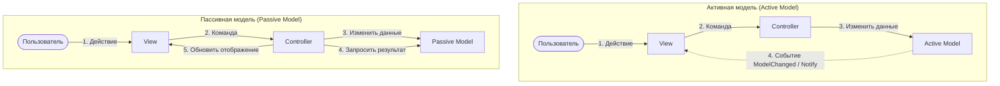
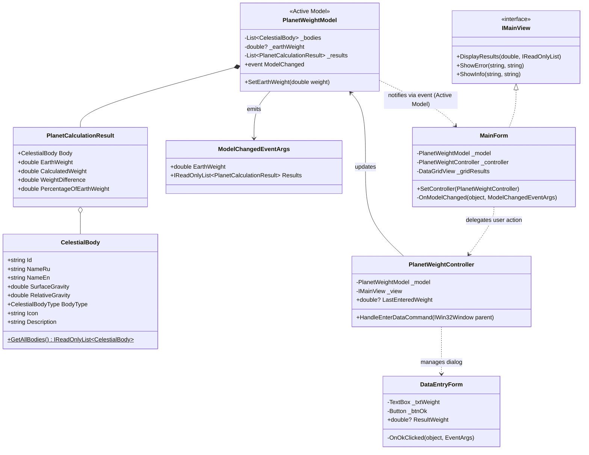
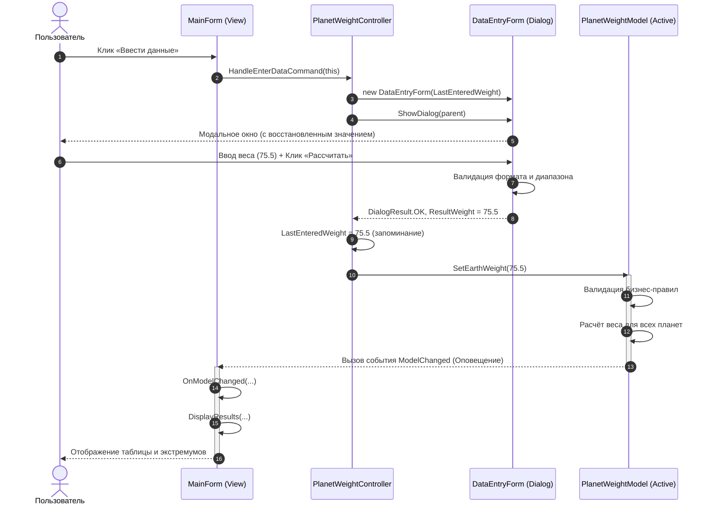

# Министерство образования Республики Беларусь
## Учреждение образования «БЕЛОРУССКИЙ ГОСУДАРСТВЕННЫЙ УНИВЕРСИТЕТ ИНФОРМАТИКИ И РАДИОЭЛЕКТРОНИКИ»
### Факультет компьютерных систем и сетей
### Кафедра электронных вычислительных машин
### Дисциплина: Жизненный цикл разработки программного обеспечения

<br><br><br><br>

# **ОТЧЁТ**
### к лабораторной работе № 1
### на тему:
## **«ИНТЕГРИРОВАННАЯ СРЕДА РАЗРАБОТКИ ПО. КАЛЬКУЛЯТОР ВЕСА НА ПЛАНЕТАХ СОЛНЕЧНОЙ СИСТЕМЫ»**
### Вариант: Калькулятор веса на разных планетах

<br><br><br><br><br><br>

**Студент:** [ФИО Студента], гр. [Номер группы]  
**Преподаватель:** [ФИО Преподавателя]  

<br><br><br>

**Минск 2026**

---

## 1 ЦЕЛЬ И ЗАДАЧИ

**Цель работы:**  
Изучить основные функциональные возможности современной интегрированной среды разработки Visual Studio Code при создании объектно-ориентированного программного комплекса на языке C# (.NET 9), освоить механизмы интерактивной пошаговой отладки оконного приложения с графическим интерфейсом (Windows Forms), настроить инструментарий проектирования с использованием UML и SysML v2, а также реализовать архитектурный паттерн **MVC с активной моделью** (Active Model) и исследовать его отличия от пассивной модели и совмещённого контроллера.

**Задачи работы:**
1. **Выбор и согласование стека технологий:** Выбор языка C# (.NET 9) и среды разработки Visual Studio Code.
2. **Настройка среды разработки и расширений:** Установка и конфигурирование плагинов для C#, UML (PlantUML) и системной инженерии SysML v2.
3. **Освоение средств навигации и отладки:** Изучение горячих клавиш, приемов редактирования, установка точек останова (Breakpoints), пошаговое выполнение (Step Over, Step Into, Step Out), анализ стека вызовов и инспекция локальных переменных.
4. **Проектирование архитектуры MVC:** Разработка диаграммы классов UML и системной модели SysML v2 для калькулятора веса на планетах с активной моделью.
5. **Реализация приложения «Калькулятор веса на планетах»:**
   - Главная форма с отображением сводной таблицы небесных тел (Меркурий, Венера, Земля, Луна, Марс, Юпитер, Сатурн, Уран, Нептун, Плутон), экстремумов веса и кнопкой «Ввести данные».
   - Дополнительное модальное диалоговое окно ввода веса с валидацией диапазона (0.1 .. 1000 кг), поддержкой разделителей (запятая/точка) и выводом ошибок.
   - Механизм запоминания и восстановления последнего введённого значения при повторном открытии диалога.
   - Реализация активной модели с генерацией событий `ModelChanged` и автоматическим обновлением пользовательского интерфейса.
6. **Сравнительный анализ архитектурных паттернов:** Детальное исследование преимуществ и компромиссов Активной модели, Пассивной модели и Совмещённого контроллера с пассивной моделью.
7. **Тестирование и оформление отчёта:** Написание модульных тестов (xUnit) для валидации и формул, ответы на контрольные вопросы.

---

## 2 КРАТКИЕ ТЕОРЕТИЧЕСКИЕ СВЕДЕНИЯ

### 2.1 Интегрированная среда разработки и её компоненты
**Интегрированная среда разработки (IDE, Integrated Development Environment)** — это комплексное программное обеспечение, объединяющее в едином рабочем пространстве полный набор инструментов, необходимых для создания, модификации, сборки, тестирования и отладки программного обеспечения.

Современная IDE (в частности, платформа Visual Studio Code с языковыми серверами) включает в себя следующие ключевые компоненты:
1. **Интеллектуальный редактор исходного кода (Code Editor):** обеспечивает подсветку синтаксиса, контекстное автодополнение кода (IntelliSense), автоформатирование, быстрые исправления (Quick Fixes / Intentions), подсветку синтаксических и семантических ошибок на лету.
2. **Система сборки и компиляции (Build System):** транслирует исходный код в исполняемые модули или промежуточный байт-код (CIL / bytecode). В стеке .NET эту роль выполняет утилита `dotnet build` и движок `MSBuild`.
3. **Отладчик (Debugger):** инструмент управления выполнением программы, позволяющий приостанавливать исполнение на контрольных точках (Breakpoints), выполнять пошаговые переходы по операторам, просматривать состояние памяти, регистров, локальных переменных и стек вызовов.
4. **Средства навигации и рефакторинга:** безопасное переименование идентификаторов (F2), переход к определению символа (F12), поиск всех ссылок на сущность (Shift+F12), просмотр иерархии типов и вызовов.
5. **Встроенный терминал и средства управления задачами (Tasks):** позволяют выполнять консольные команды автоматизации, запускать внешние линтеры и тесты без переключения в сторонние приложения.
6. **Интеграция с системами контроля версий (VCS / Git):** графический интерфейс для выполнения коммитов, создания веток, анализа diff-разницы и разрешения конфликтов слияния.
7. **Менеджер пакетов и расширений (Extension Ecosystem):** модульная архитектура, позволяющая подключать специализированные плагины для моделирования (UML, SysML v2) и языковой поддержки.

### 2.2 Редактирование и навигация в Visual Studio Code
Visual Studio Code предоставляет разработчику высокопроизводительный редактор со следующими основными приемами работы:
- **Быстрая навигация по файлам и символам:** `Ctrl+P` (переход к файлу по имени), `Ctrl+T` / `Ctrl+Shift+O` (переход к классу, методу или символу).
- **Переход к определению (Go to Definition):** клавиша `F12` (или `Ctrl + клик мыши`) мгновенно открывает объявление вызываемого метода или типа данных; возврат назад — `Alt + Стрелка влево`.
- **Контекстное автодополнение (IntelliSense):** вызывается сочетанием `Ctrl+Space`.
- **Быстрые действия и исправления (Quick Fix / Refactoring):** `Ctrl+.` или `Alt+Enter` предлагает генерацию конструкторов, импорт отсутствующих пространств имен (`using`), удаление неиспользуемых директив.
- **Автоматическое форматирование кода:** `Shift+Alt+F` форматирует активный документ в соответствии со стандартами стиля C#.
- **Мультикурсорное редактирование:** `Alt + клик` позволяет редактировать несколько строк одновременно.

### 2.3 Сборка, запуск и отладка .NET-приложения
Компилятор языка C# (`Roslyn`) компилирует исходные файлы `.cs` в файлы сборок (`.dll` или `.exe`), содержащие команды на общем промежуточном языке CIL (Common Intermediate Language) и метаданные типов. При запуске среда исполнения .NET CLR (Common Language Runtime) транслирует CIL-байткод в машинные инструкции целевого процессора с помощью JIT-компилятора (Just-In-Time).

Сборка и запуск проекта выполняются командами:
- `dotnet build` — компиляция проекта и проверка синтаксиса;
- `dotnet run` — компиляция и запуск исполняемого файла;
- `dotnet test` — запуск набора модульных тестов с формированием отчёта.

В процессе отладки используются ключевые возможности:
- **Breakpoint (`F9`):** точка останова, на которой исполнение приостанавливается до выполнения помеченной строки.
- **Start Debugging (`F5`):** запуск программы под управлением отладчика `.NET Core Debugger (vsdbg)`.
- **Step Over (`F10`):** шаг с обходом — выполнение текущей строки кода без захода внутрь вызываемых функций.
- **Step Into (`F11`):** шаг с заходом — переход внутрь тела вызываемого метода.
- **Step Out (`Shift+F11`):** шаг с выходом — завершение выполнения текущего метода и возврат в точку вызова.
- **Call Stack:** панель, отражающая иерархию активных стековых фреймов вызова методов.
- **Watch / Locals:** просмотр и вычисление значений выражений в реальном времени.

### 2.4 Архитектурный паттерн MVC
Паттерн **Model-View-Controller (MVC)** — фундаментальный шаблон проектирования архитектуры программного обеспечения, разделяющий приложение на три независимых компонента:
1. **Model (Модель):** содержит предметную логику (бизнес-правила), выполняет математические расчеты, управляет состоянием предметной области и обеспечивает целостность данных. Модель полностью изолирована от элементов пользовательского интерфейса (не содержит ссылок на формы, окна, кнопки).
2. **View (Представление):** отвечает за визуальное отображение данных пользователю и сбор первичных пользовательских событий (нажатия клавиш, клики мыши, ввод текста).
3. **Controller (Контроллер):** выступает координатором пользовательского взаимодействия. Он перехватывает команды пользователя из представления, преобразует и валидирует входные параметры, инициирует изменение состояния Модели и управляет переходами между окнами приложения.

Такое разделение существенно повышает тестируемость (бизнес-логику модели можно тестировать в автоматических тестах без запуска GUI), масштабируемость и ремонтопригодность программного продукта.

### 2.5 Активная и пассивная модель
В зависимости от способа доставки информации об изменении состояния от Модели к Представлению различают два варианта паттерна MVC:



- **Активная модель (Active Model):**
  Модель является субъектом (Subject) в паттерне «Наблюдатель» (Observer). При любом изменении своего внутреннего состояния Модель самостоятельно генерирует событие (в C# — `event EventHandler<ModelChangedEventArgs>`). Представление подписано на это событие и автоматически перерисовывает экран при его возникновении. Модель не знает конкретный тип формы-подписчика, что сохраняет слабую связанность (Loose Coupling).
- **Пассивная модель (Passive Model):**
  Модель представляет собой чистое хранилище данных и логики, не содержащее механизмов уведомления. Контроллер полностью берёт на себя координацию: он вызывает метод изменения в модели, затем сам считывает изменённые данные из модели и принудительно передаёт их представлению методом `view.DisplayResults(...)`.

---

## 3 ОПИСАНИЕ ВЫПОЛНЕННОГО ВАРИАНТА ЗАДАНИЯ

### 3.1 Постановка задачи
**Формулировка задания:**  
> Разработать калькулятор веса на разных планетах. Человек вводит свой вес на Земле, программа должна рассчитать, сколько он будет весить на других планетах Солнечной системы (Меркурий, Нептун и т.д.). На главной форме расположить кнопку «Ввести данные». По нажатию на нее открывается дополнительное окно для ввода информации. Последние введенные данные необходимо запоминать в главной форме и восстанавливать при повторном вводе. После этого на главной форме отобразить результат вычислений. Если введены некорректные данные — показать сообщение об ошибке. Добавить каркас MVC с активной моделью.

**Формула расчёта:**  
Вес человека на небесном теле $W_{body}$ пропорционален локальному ускорению свободного падения $g_{body}$:
$$W_{body} = W_{earth} 	imes rac{g_{body}}{g_{earth}}$$
где:
- $W_{earth}$ — вес человека на Земле (в кг);
- $g_{earth} = 9.80665 	ext{ м/с}^2$ — стандартное ускорение свободного падения на поверхности Земли;
- $g_{body}$ — ускорение свободного падения на поверхности рассматриваемой планеты/спутника.

В состав небесных тел включены:
1. **Меркурий** ($g = 3.70 	ext{ м/с}^2$, $37.7\%$ земного веса);
2. **Венера** ($g = 8.87 	ext{ м/с}^2$, $90.5\%$ земного веса);
3. **Земля** ($g = 9.80665 	ext{ м/с}^2$, $100.0\%$ земного веса);
4. **Луна** ($g = 1.62 	ext{ м/с}^2$, $16.5\%$ земного веса);
5. **Марс** ($g = 3.72 	ext{ м/с}^2$, $37.9\%$ земного веса);
6. **Юпитер** ($g = 24.79 	ext{ м/с}^2$, $252.7\%$ земного веса);
7. **Сатурн** ($g = 10.44 	ext{ м/с}^2$, $106.4\%$ земного веса);
8. **Уран** ($g = 8.69 	ext{ м/с}^2$, $88.6\%$ земного веса);
9. **Нептун** ($g = 11.15 	ext{ м/с}^2$, $113.7\%$ земного веса);
10. **Плутон** ($g = 0.62 	ext{ м/с}^2$, $6.3\%$ земного веса).

### 3.2 Настройка среды и расширений для UML и SysML v2
Для выполнения работы настроена среда Visual Studio Code со специализированными расширениями:
1. **C# Dev Kit / C# (OmniSharp)** (`ms-dotnettools.csharp` / `anysphere.csharp`): обеспечивает компиляцию, подсветку синтаксиса, рефакторинг и интеграцию с отладчиком `.NET`.
2. **PlantUML** (`jebbs.plantuml`): инструмент для рендеринга и визуализации UML-диаграмм (классов, последовательности) непосредственно в редакторе по нажатию `Alt+D`.
3. **SysML v2 Language Support** (`JamieD.sysml-v2-support` / `sensmetry.syside-editor`): обеспечивает поддержку стандарта моделирования системной инженерии OMG SysML v2 (пакеты, определения частей `part def`, порты, коннекторы и спецификации действий).
4. **Mermaid Preview** (`vstirbu.vscode-mermaid-preview`): позволяет в режиме реального времени визуализировать графы и диаграммы последовательности в файлах Markdown.



### 3.3 Архитектурная модель в нотации SysML v2
В соответствии с требованиями задания, архитектура спроектирована с использованием стандарта SysML v2:

```sysml
package PlanetWeightCalculatorPackage {
    doc /* Архитектурная спецификация MVC в стандарте SysML v2 */

    port def DataFlowPort;
    port def NotificationPort;
    port def UserActionPort;

    part def PlanetWeightModel {
        attribute earthWeight : ScalarValues::Real;
        attribute isCalculated : ScalarValues::Boolean;
        port notifyOut : NotificationPort;
        
        action def CalculatePlanetWeights {
            in weight : ScalarValues::Real;
            out results : ScalarValues::Real[10];
        }
    }

    part def PlanetWeightView {
        port userActionOut : UserActionPort;
        port notifyIn : NotificationPort;
    }

    part def PlanetWeightController {
        attribute lastEnteredWeight : ScalarValues::Real;
        port userActionIn : UserActionPort;
        port modelControlOut : DataFlowPort;
    }

    part def PlanetWeightCalculatorSystem {
        part model : PlanetWeightModel;
        part view : PlanetWeightView;
        part controller : PlanetWeightController;

        connect view.userActionOut to controller.userActionIn;
        connect controller.modelControlOut to model.notifyOut;
        connect model.notifyOut to view.notifyIn; // Активная модель уведомляет View
    }
}
```

### 3.4 Демонстрация работы отладчика в VS Code
В проекте настроен файл конфигурации отладки `.vscode/launch.json` с профилем `.NET Core Launch (WinForms)` и задача предсборки `build` в `.vscode/tasks.json`.

**Сценарий демонстрации пошаговой отладки:**
1. **Установка Breakpoint (`F9`):** Точка останова устанавливается на строке `_model.SetEarthWeight(weight);` в классе `PlanetWeightController.cs`, а также в методе `SetEarthWeight` модели `PlanetWeightModel.cs`.
2. **Запуск отладки (`F5`):** Запускается процесс приложения под управлением отладчика `vsdbg`.
3. **Триггер события:** В окне приложения нажимается кнопка «Ввести данные», вводится вес `75.5` и нажимается «Рассчитать».
4. **Остановка на контрольной точке:** Выполнение замораживается на точке останова. В окне **Variables (Locals)** инспектируются переменные:
   - `weight` = `75.5`
   - `this.LastEnteredWeight` = `75.5`
5. **Шаг с заходом (`F11` Step Into):** Отладчик переходит в метод `SetEarthWeight(double weight)` класса `PlanetWeightModel`.
6. **Шаг с обходом (`F10` Step Over):** Выполняется проверка диапазона `if (weight <= 0.0)`.
7. **Инспекция цикла:** В цикле `foreach (var body in _bodies)` отслеживается создание объектов `PlanetCalculationResult`.
8. **Вызов события:** При исполнении строки `OnModelChanged(...)` стек вызовов (**Call Stack**) показывает переход в подписчик `MainForm.OnModelChanged`, подтверждая реактивный отклик Активной Модели.



### 3.5 Модель (PlanetWeightModel)
Класс `PlanetWeightModel` реализует паттерн **Активная модель**. Он инкапсулирует коллекцию поддерживаемых небесных тел `CelestialBody`, текущий вес на Земле и список результатов `PlanetCalculationResult`.

```csharp
public class PlanetWeightModel
{
    private readonly List<CelestialBody> _bodies;
    private double? _earthWeight;
    private readonly List<PlanetCalculationResult> _results = [];

    // Событие активной модели для автоматического уведомления View
    public event EventHandler<ModelChangedEventArgs>? ModelChanged;

    public double? EarthWeight => _earthWeight;
    public IReadOnlyList<PlanetCalculationResult> Results => _results.AsReadOnly();

    public void SetEarthWeight(double weight)
    {
        if (weight <= 0.0)
            throw new ArgumentOutOfRangeException(nameof(weight), "Вес должен быть строго больше нуля!");
        if (weight > 1000.0)
            throw new ArgumentOutOfRangeException(nameof(weight), "Вес не может превышать 1000 кг!");

        _earthWeight = Math.Round(weight, 2);
        _results.Clear();

        foreach (var body in _bodies)
        {
            _results.Add(new PlanetCalculationResult(body, _earthWeight.Value));
        }

        // Оповещение подписчиков
        OnModelChanged(new ModelChangedEventArgs(_earthWeight.Value, _results.AsReadOnly()));
    }

    protected virtual void OnModelChanged(ModelChangedEventArgs e) => ModelChanged?.Invoke(this, e);
}
```

### 3.6 Представление (MainForm и DataEntryForm)
Графический интерфейс состоит из двух окон:
1. `MainForm` (Главное окно):
   - Реализует контракт `IMainView`;
   - В конструкторе подписывается на событие модели: `_model.ModelChanged += OnModelChanged;`;
   - Отображает результаты в полнофункциональной таблице `DataGridView` (название, иконка, ускорение $g$, процент от земного веса, итоговый вес и разница с земным значением);
   - Выполняет цветовую дифференциацию (зелёный цвет — вес меньше земного, красный — больше земного);
   - Выводит специальные информационные карточки с указанием самой «лёгкой» планеты (Луна / Плутон) и самой «тяжёлой» планеты (Юпитер);
   - Передает вызов при нажатии кнопки «Ввести данные» в метод контроллера `_controller.HandleEnterDataCommand(this)`.
2. `DataEntryForm` (Диалоговое окно):
   - Модальное окно (`ShowDialog`), принимающее в конструкторе `initialWeight`;
   - Автоматически предзаполняет текстовое поле предыдущим значением и выделяет текст для мгновенного изменения;
   - Поддерживает закрытие по клавише `Esc` (CancelButton) и подтверждение по клавише `Enter` (AcceptButton).

### 3.7 Контроллер (PlanetWeightController)
Контроллер отвечает за управление потоком данных и соблюдение сценариев пользовательского взаимодействия:
- Управляет жизненным циклом диалога `DataEntryForm`;
- Хранит свойство `LastEnteredWeight` (запоминание последних введённых данных);
- Перехватывает исключения бизнес-валидации модели и передаёт сообщения об ошибках в представление.

```csharp
public class PlanetWeightController
{
    private readonly PlanetWeightModel _model;
    private readonly IMainView _view;

    public double? LastEnteredWeight { get; private set; }

    public PlanetWeightController(PlanetWeightModel model, IMainView view)
    {
        _model = model ?? throw new ArgumentNullException(nameof(model));
        _view = view ?? throw new ArgumentNullException(nameof(view));
    }

    public void HandleEnterDataCommand(IWin32Window parentWindow)
    {
        try
        {
            using var dialog = new DataEntryForm(LastEnteredWeight);
            if (dialog.ShowDialog(parentWindow) == DialogResult.OK && dialog.ResultWeight.HasValue)
            {
                double weight = dialog.ResultWeight.Value;
                LastEnteredWeight = weight; // Запоминание
                _model.SetEarthWeight(weight); // Обновление активной модели
            }
        }
        catch (Exception ex)
        {
            _view.ShowError("Ошибка", ex.Message);
        }
    }
}
```

### 3.8 Запоминание данных и многоуровневая обработка ошибок
В приложении реализована трехуровневая система проверки корректности данных:
1. **Синтаксическая проверка во View (`DataEntryForm`):**
   - Проверка на пустую строку или пробелы: вывод предупреждения «Поле ввода не может быть пустым!».
   - Нормализация локали: автоматическая замена запятой на точку (`rawText.Replace(',', '.')`), что обеспечивает стабильный парсинг при любых региональных стандартах операционной системы.
   - Проверка типа: безопасный парсинг `double.TryParse` с сообщением о некорректном формате символов.
2. **Диапазонная валидация в диалоге:**
   - Предотвращение отрицательных, нулевых и аномально высоких величин (допустимо: $0.1 \le W \le 1000$ кг).
3. **Семантическая инвариантная валидация в Модели (`PlanetWeightModel`):**
   - Генерация `ArgumentOutOfRangeException` при попытке нарушить бизнес-правила модели.
4. **Восстановление состояния:**
   - Значение сохраняется в свойстве контроллера `LastEnteredWeight`. При повторном нажатии на кнопку «Ввести данные» в TextBox диалога автоматически передается и выделяется предыдущее значение.

### 3.9 Сравнительный анализ: Активная модель, Пассивная модель и Совмещённый контроллер
В проекте реализован демонстрационный модуль `EducationalVariants.cs`, наглядно сопоставляющий три архитектурных подхода, предусмотренных заданием лабораторной работы:

| Критерий | Активная модель (Active Model) | Пассивная модель (Passive Model) | Совмещённый контроллер |
| :--- | :--- | :--- | :--- |
| **Способ оповещения View** | Модель сама генерирует событие (`ModelChanged`), View подписано на него | Контроллер явно вызывает метод обновления View после изменения модели | Контроллер вызывает callback-функции интерфейса напрямую |
| **Степень связанности (Coupling)** | Минимальная: модель знает только сигнатуру своего события (Observer) | Средняя: контроллер жестко связывает методы модели и представления | Высокая: контроллер и модель объединены в один неделимый класс |
| **Поддержка нескольких View** | Идеальная: к событию одной модели могут подключиться десятки форм, графиков, виджетов | Затруднённая: контроллер обязан знать обо всех окнах и обновлять каждое вручную | Крайне сложная: логика монолитна |
| **Сложность реализации** | Требует объявления событий и корректной отписки от них (`Dispose`) | Простая: прямолинейный последовательный процедурный код | Наименьшая (подходит для базового освоения) |
| **Применимость** | Сложные интерактивные системы, реактивные GUI, биржевые терминалы | Традиционные веб-приложения (Request/Response), CRUD-формы | Небольшие учебные утилиты, микро-скрипты |

---

## 4 РЕЗУЛЬТАТЫ РАБОТЫ

### 4.1 Пользовательский интерфейс и сценарии использования
1. **Первоначальный запуск:** Главное окно отображает приветственный баннер, кнопку «Ввести данные», пустую сетку небесных тел и информационный статус в строке состояния: *«Готов к работе. Ожидание ввода данных пользователя»*.
2. **Открытие модального окна:** При клике на кнопку «Ввести данные» открывается центрированное диалоговое окно `DataEntryForm`. Курсор автоматически позиционируется в поле ввода.
3. **Ввод корректных данных:** Пользователь вводит значение (например, `70` или `82,4`). По нажатию клавиши `Enter` окно закрывается. Модель рассчитывает параметры, генерирует событие, и таблица главной формы мгновенно заполняется данными для 10 небесных тел.
4. **Информационные индикаторы:** Главная форма рассчитывает экстремумы и динамически выводит:
   - *Легче всего: Плутон (4.43 кг, 6.3%) / Луна (11.57 кг, 16.5%)* — зелёный цвет.
   - *Тяжелее всего: Юпитер (176.89 кг, 252.7%)* — красный цвет.
5. **Повторный ввод (восстановление данных):** При повторном клике на «Ввести данные» открывшееся окно содержит ранее введённое значение (`82.4`), выделенное синим цветом, готовое для быстрой корректировки без необходимости стирать текст вручную.
6. **Обработка ошибок:** При попытке ввести текст (например, `abc`) или отрицательное число (`-50`) открывается окно предупреждения `MessageBox` с подробным описанием ошибки, а фокус ввода возвращается в текстовое поле.

### 4.2 Модульное тестирование (xUnit)
В проекте `PlanetWeightCalculator.Tests` разработано 10 автоматических тестов, полностью покрывающих бизнес-логику:
- `GetAllBodies_Returns10CelestialBodies`: проверяет целостность справочника планет и относительные коэффициенты гравитации.
- `ActiveModel_CalculatesCorrectWeights_AndFiresEvent`: проверяет корректность расчёта веса на Земле, Юпитере, Луне и генерацию события `ModelChanged`.
- `ActiveModel_InvalidWeight_ThrowsArgumentOutOfRangeException`: тестирует защиту от отрицательных, нулевых и запредельных значений.
- `PassiveModel_CalculatesWithoutFiringEvents`: проверяет поведение пассивной модели.
- `CombinedController_ProcessesValidAndInvalidInput`: проверяет парсинг запятых, точек и обработку ошибок совмещённым контроллером.

**Результат запуска `dotnet test`:**
```text
Тестовый запуск для PlanetWeightCalculator.Tests.dll (.NETCoreApp,Version=v9.0)
Версия VSTest 17.14.1 (x64)
Запуск выполнения тестов; подождите...
Пройден!   : не пройдено 0, пройдено 10, пропущено 0, всего 10, длительность 361 ms.
```

---

## 5 ОТВЕТЫ НА КОНТРОЛЬНЫЕ ВОПРОСЫ

### Вопрос 1. Какие компоненты входят в состав IDE?
**Ответ:**  
В состав современной интегрированной среды разработки (IDE) входят:
1. **Редактор исходного кода:** компонент с подсветкой синтаксиса, интеллектуальным автодополнением (IntelliSense), системой сниппетов, инспекцией кода и быстрыми исправлениями.
2. **Компилятор / интерпретатор и система сборки:** инструментарий преобразования кода в бинарные модули или байт-код (например, компилятор `Roslyn` и сборочная утилита `dotnet build` / `MSBuild`).
3. **Отладчик (Debugger):** подсистема контроля выполнения, позволяющая выставлять точки останова (Breakpoints), выполнять пошаговую трассировку (Step Over/Into/Out), просматривать стек вызовов и инспектировать переменные памяти.
4. **Инструменты навигации и рефакторинга:** модули быстрого поиска файлов и символов, перехода к объявлению (`F12`), безопасного переименования сущностей во всем проекте (`F2`).
5. **Встроенный терминал:** командная консоль для запуска скриптов, тестов и внешних утилит.
6. **Клиент системы контроля версий (VCS):** графический интерфейс для работы с Git (коммиты, ветки, просмотр diff).
7. **Менеджер пакетов и расширений:** интерфейс управления сторонними зависимостями (NuGet) и плагинами среды.

### Вопрос 2. Каковы основные приемы работы с редактором кода?
**Ответ:**  
К основным профессиональным приемам работы с редактором относятся:
- **Интеллектуальное автодополнение (Code Completion):** выбор методов и свойств из всплывающего контекстного меню (`Ctrl+Space`).
- **Быстрые исправления и рефакторинг:** использование контекстного меню подсказок (`Ctrl+.` или `Alt+Enter`) для автоматической генерации отсутствующих конструкторов, свойств или добавления необходимых директив `using`.
- **Навигация по коду:** мгновенный переход к определению метода или типа (`F12`), переход назад (`Alt + Стрелка влево`), поиск всех мест использования сущности (`Shift+F12`).
- **Автоматическое форматирование документа:** приведение кода к принятому стилю отступами и переносами по нажатию `Shift+Alt+F`.
- **Быстрый поиск и мультиредактирование:** мгновенный поиск файлов (`Ctrl+P`), глобальный поиск по проекту (`Ctrl+Shift+F`), множественные курсоры (`Alt + клик`) для одновременного редактирования повторяющихся фрагментов.

### Вопрос 3. Каким образом выполняется сборка и запуск проекта?
**Ответ:**  
В стеке технологий .NET (C#) сборка и запуск могут осуществляться как из графического интерфейса IDE, так и из командной строки:
1. **Сборка проекта:**
   - Выполняется с помощью команды `dotnet build [путь_к_csproj]`.
   - В процессе сборки анализируются зависимости проекта (файлы `.csproj`), компилятор C# (`csc / Roslyn`) транслирует исходный код в исполняемую сборку формата PE/COFF, содержащую байт-код CIL (Common Intermediate Language) и метаданные типов, которые сохраняются в каталоге `bin/Debug/net9.0-windows/`.
2. **Запуск проекта:**
   - В обычном режиме: команда `dotnet run` (или `Ctrl+F5` в IDE). Среда CLR загружает сборку, JIT-компилятор на лету преобразует CIL-инструкции в машинный код процессора и запускает метод `Main()`.
   - В режиме отладки: нажатие клавиши `F5`. IDE связывает процесс приложения с отладчиком (`vsdbg`), активирует точки останова и направляет отладочные сообщения в консоль отладки.

### Вопрос 4. Что такое MVC?
**Ответ:**  
**MVC (Model-View-Controller)** — это фундаментальный архитектурный паттерн, разделяющий приложение на три взаимосвязанные, но слабозависимые части:
1. **Model (Модель):** ядро приложения, содержащее бизнес-логику, математические формулы, структуры данных и правила валидации. В данной работе это класс `PlanetWeightModel`, рассчитывающий вес для 10 небесных тел. Модель ничего не знает о кнопках, окнах и текстовых полях.
2. **View (Представление):** пользовательский интерфейс, отвечающий за отображение данных человеку и генерацию сигналов о действиях пользователя. В работе это формы `MainForm` и `DataEntryForm`.
3. **Controller (Контроллер):** посредник, принимающий пользовательские воздействия от представления, транслирующий их в команды изменения модели и управляющий диалоговыми окнами (`PlanetWeightController`).

Разделение по MVC предотвращает появление монолитного «спагетти-кода», позволяет независимо изменять внешний вид без риска нарушить математические расчеты и дает возможность тестировать бизнес-логику модели автономными модульными тестами.

### Вопрос 5. Чем отличается активная модель от пассивной?
**Ответ:**  
Главное отличие заключается в **направлении и механизме инициации обновления представления (View)**:
1. **Активная модель (Active Model):**
   - Модель реализует паттерн «Наблюдатель» (Observer) и содержит событие (в C# — `event EventHandler<ModelChangedEventArgs>`).
   - Представление подписывается на событие модели напрямую.
   - Когда контроллер вызывает метод модификации модели, модель выполняет расчеты и **сама инициирует событие**, уведомляя всех зарегистрированных подписчиков (View).
   - Контроллер освобожден от обязанности обновлять представление, что делает систему реактивной и позволяет подключать множество независимых представлений к одной модели.
2. **Пассивная модель (Passive Model):**
   - Модель не содержит событий и не знает о наличии каких-либо наблюдателей.
   - Она просто сохраняет состояние и возвращает результаты по запросу.
   - Контроллер берет на себя всю рутину: он вызывает расчет в модели, затем сам забирает вычисленные данные и вручную передает их представлению методом `view.DisplayResults(...)`.

---

## ЗАКЛЮЧЕНИЕ

В ходе выполнения лабораторной работы № 1 по дисциплине «Жизненный цикл разработки программного обеспечения»:
1. Была изучена и практически освоена среда разработки Visual Studio Code применительно к объектно-ориентированной разработке на языке C# под платформу .NET 9.
2. Установлены и настроены специализированные инструменты архитектурного моделирования: расширение **PlantUML** для построения UML-диаграмм классов и последовательностей, а также поддержка системного стандарта **SysML v2**.
3. На практике освоены механизмы отладки программного обеспечения: установка точек останова (Breakpoints), пошаговая трассировка (Step Over, Step Into, Step Out), инспекция значений локальных переменных и анализ стека вызовов.
4. Разработано оконное приложение «Калькулятор веса на разных планетах» с использованием фреймворка Windows Forms, включающее:
   - Основное окно со сводной таблицей расчётов для 10 небесных тел, визуальной индикацией и выделением экстремумов;
   - Дополнительное модальное окно ввода исходных данных;
   - Механизм сохранения и автоматического восстановления последнего введённого веса;
   - Многоуровневую систему валидации входных данных с выводом сообщений об ошибках.
5. Приложение спроектировано строго на основе архитектурного паттерна **MVC с активной моделью (Active Model)**. Дополнительно реализованы и проанализированы варианты с пассивной моделью и совмещённым контроллером.
6. Разработан и успешно протестирован пакет из 10 модульных тестов на базе фреймворка xUnit, подтвердивший математическую точность и устойчивость к некорректным входным данным.

---

## ПРИЛОЖЕНИЕ А. Листинг исходного кода программы

### А.1 Файл Models/CelestialBody.cs
```csharp
namespace PlanetWeightCalculator.Models;

public enum CelestialBodyType
{
    Planet,
    DwarfPlanet,
    Moon
}

public class CelestialBody
{
    public string Id { get; }
    public string NameRu { get; }
    public string NameEn { get; }
    public double SurfaceGravity { get; } // м/с^2
    public double RelativeGravity { get; } // относительно Земли (g_planet / g_earth)
    public CelestialBodyType BodyType { get; }
    public string Icon { get; }
    public string Description { get; }

    public CelestialBody(
        string id,
        string nameRu,
        string nameEn,
        double surfaceGravity,
        CelestialBodyType bodyType,
        string icon,
        string description)
    {
        Id = id;
        NameRu = nameRu;
        NameEn = nameEn;
        SurfaceGravity = surfaceGravity;
        RelativeGravity = surfaceGravity / 9.80665;
        BodyType = bodyType;
        Icon = icon;
        Description = description;
    }

    public static IReadOnlyList<CelestialBody> GetAllBodies() =>
    [
        new("mercury", "Меркурий", "Mercury", 3.70, CelestialBodyType.Planet, "☿", "Ближайшая к Солнцу планета"),
        new("venus", "Венера", "Venus", 8.87, CelestialBodyType.Planet, "♀", "Вторая планета с плотной атмосферой"),
        new("earth", "Земля", "Earth", 9.80665, CelestialBodyType.Planet, "♁", "Базовая планета отсчёта (1.00 g)"),
        new("moon", "Луна", "Moon", 1.62, CelestialBodyType.Moon, "☾", "Спутник Земли, гравитация в ~6 раз ниже"),
        new("mars", "Марс", "Mars", 3.72, CelestialBodyType.Planet, "♂", "Красная планета с разреженной атмосферой"),
        new("jupiter", "Юпитер", "Jupiter", 24.79, CelestialBodyType.Planet, "♃", "Крупнейший газовый гигант Солнечной системы"),
        new("saturn", "Сатурн", "Saturn", 10.44, CelestialBodyType.Planet, "♄", "Газовый гигант со знаменитыми кольцами"),
        new("uranus", "Уран", "Uranus", 8.69, CelestialBodyType.Planet, "♅", "Ледяной гигант с сильным наклоном оси"),
        new("neptune", "Нептун", "Neptune", 11.15, CelestialBodyType.Planet, "♆", "Самая удалённая планета Солнечной системы"),
        new("pluto", "Плутон", "Pluto", 0.62, CelestialBodyType.DwarfPlanet, "♇", "Карликовая планета в поясе Койпера")
    ];
}
```

### А.2 Файл Models/PlanetCalculationResult.cs
```csharp
namespace PlanetWeightCalculator.Models;

public class PlanetCalculationResult
{
    public CelestialBody Body { get; }
    public double EarthWeight { get; }
    public double CalculatedWeight { get; }
    public double WeightDifference { get; }
    public double PercentageOfEarthWeight => Body.RelativeGravity * 100.0;

    public PlanetCalculationResult(CelestialBody body, double earthWeight)
    {
        Body = body ?? throw new ArgumentNullException(nameof(body));
        EarthWeight = earthWeight;
        CalculatedWeight = Math.Round(earthWeight * body.RelativeGravity, 2);
        WeightDifference = Math.Round(CalculatedWeight - earthWeight, 2);
    }
}
```

### А.3 Файл Models/PlanetWeightModel.cs (Активная модель)
```csharp
namespace PlanetWeightCalculator.Models;

public class PlanetWeightModel
{
    private readonly List<CelestialBody> _bodies;
    private double? _earthWeight;
    private readonly List<PlanetCalculationResult> _results = [];

    public event EventHandler<ModelChangedEventArgs>? ModelChanged;

    public double? EarthWeight => _earthWeight;
    public IReadOnlyList<PlanetCalculationResult> Results => _results.AsReadOnly();
    public bool HasData => _earthWeight.HasValue && _results.Count > 0;

    public PlanetWeightModel()
    {
        _bodies = CelestialBody.GetAllBodies().ToList();
    }

    public void SetEarthWeight(double weight)
    {
        if (weight <= 0.0)
            throw new ArgumentOutOfRangeException(nameof(weight), "Вес должен быть строго больше нуля!");

        if (weight > 1000.0)
            throw new ArgumentOutOfRangeException(nameof(weight), "Вес не может превышать 1000 кг (максимально допустимое значение)!");

        _earthWeight = Math.Round(weight, 2);
        _results.Clear();

        foreach (var body in _bodies)
        {
            _results.Add(new PlanetCalculationResult(body, _earthWeight.Value));
        }

        OnModelChanged(new ModelChangedEventArgs(_earthWeight.Value, _results.AsReadOnly()));
    }

    protected virtual void OnModelChanged(ModelChangedEventArgs e)
    {
        ModelChanged?.Invoke(this, e);
    }
}
```

### А.4 Файл Controllers/PlanetWeightController.cs
```csharp
using PlanetWeightCalculator.Models;
using PlanetWeightCalculator.Views;

namespace PlanetWeightCalculator.Controllers;

public class PlanetWeightController
{
    private readonly PlanetWeightModel _model;
    private readonly IMainView _view;

    public double? LastEnteredWeight { get; private set; }

    public PlanetWeightController(PlanetWeightModel model, IMainView view)
    {
        _model = model ?? throw new ArgumentNullException(nameof(model));
        _view = view ?? throw new ArgumentNullException(nameof(view));
    }

    public void HandleEnterDataCommand(IWin32Window parentWindow)
    {
        try
        {
            using var dialog = new DataEntryForm(LastEnteredWeight);
            var result = dialog.ShowDialog(parentWindow);

            if (result == DialogResult.OK && dialog.ResultWeight.HasValue)
            {
                double weight = dialog.ResultWeight.Value;
                LastEnteredWeight = weight;
                _model.SetEarthWeight(weight);
            }
        }
        catch (ArgumentOutOfRangeException ex)
        {
            _view.ShowError("Ошибка диапазона", ex.Message);
        }
        catch (Exception ex)
        {
            _view.ShowError("Непредвиденная ошибка", $"Произошла ошибка при обработке данных: {ex.Message}");
        }
    }
}
```

### А.5 Файл Views/DataEntryForm.cs
```csharp
using System.Globalization;

namespace PlanetWeightCalculator.Views;

public class DataEntryForm : Form
{
    private readonly TextBox _txtWeight;
    private readonly Button _btnOk;
    private readonly Button _btnCancel;
    private readonly Label _lblPrompt;
    private readonly Label _lblHelp;

    public double? ResultWeight { get; private set; }

    public DataEntryForm(double? initialWeight = null)
    {
        Text = "Ввод данных — Вес на Земле";
        FormBorderStyle = FormBorderStyle.FixedDialog;
        MaximizeBox = false;
        MinimizeBox = false;
        StartPosition = FormStartPosition.CenterParent;
        ClientSize = new Size(420, 200);
        Font = new Font("Segoe UI", 9.75F, FontStyle.Regular, GraphicsUnit.Point);
        BackColor = Color.FromArgb(248, 249, 250);

        _lblPrompt = new Label
        {
            Text = "Введите ваш вес на Земле (в кг):",
            Location = new Point(30, 25),
            AutoSize = true,
            Font = new Font("Segoe UI", 10.5F, FontStyle.Bold),
            ForeColor = Color.FromArgb(33, 37, 41)
        };

        _txtWeight = new TextBox
        {
            Location = new Point(30, 60),
            Size = new Size(360, 29),
            Font = new Font("Segoe UI", 11F, FontStyle.Regular),
            Text = initialWeight.HasValue ? initialWeight.Value.ToString("0.##", CultureInfo.CurrentCulture) : string.Empty
        };

        _lblHelp = new Label
        {
            Text = "Допустимый диапазон: от 0.1 до 1000 кг (например: 72,5 или 80)",
            Location = new Point(30, 95),
            AutoSize = true,
            ForeColor = Color.FromArgb(108, 117, 125),
            Font = new Font("Segoe UI", 8.5F, FontStyle.Italic)
        };

        _btnOk = new Button
        {
            Text = "Рассчитать",
            Location = new Point(170, 140),
            Size = new Size(110, 35),
            BackColor = Color.FromArgb(13, 110, 253),
            ForeColor = Color.White,
            FlatStyle = FlatStyle.Flat,
            Cursor = Cursors.Hand,
            Font = new Font("Segoe UI", 9.5F, FontStyle.Bold)
        };
        _btnOk.FlatAppearance.BorderSize = 0;
        _btnOk.Click += OnOkClicked;

        _btnCancel = new Button
        {
            Text = "Отмена",
            Location = new Point(290, 140),
            Size = new Size(100, 35),
            BackColor = Color.FromArgb(222, 226, 230),
            ForeColor = Color.FromArgb(33, 37, 41),
            FlatStyle = FlatStyle.Flat,
            Cursor = Cursors.Hand
        };
        _btnCancel.FlatAppearance.BorderSize = 0;
        _btnCancel.Click += (s, e) => { DialogResult = DialogResult.Cancel; Close(); };

        AcceptButton = _btnOk;
        CancelButton = _btnCancel;

        Controls.Add(_lblPrompt);
        Controls.Add(_txtWeight);
        Controls.Add(_lblHelp);
        Controls.Add(_btnOk);
        Controls.Add(_btnCancel);

        _txtWeight.SelectAll();
    }

    private void OnOkClicked(object? sender, EventArgs e)
    {
        string rawText = _txtWeight.Text.Trim();

        if (string.IsNullOrWhiteSpace(rawText))
        {
            MessageBox.Show(
                "Поле ввода не может быть пустым! Пожалуйста, укажите ваш вес.",
                "Ошибка ввода данных",
                MessageBoxButtons.OK,
                MessageBoxIcon.Warning);
            _txtWeight.Focus();
            return;
        }

        string normalized = rawText.Replace(',', '.');

        if (!double.TryParse(normalized, NumberStyles.Float, CultureInfo.InvariantCulture, out double parsedWeight))
        {
            MessageBox.Show(
                $"Значение «{rawText}» не является корректным числом! Введите числовое значение (например: 75.5 или 68).",
                "Некорректный формат",
                MessageBoxButtons.OK,
                MessageBoxIcon.Error);
            _txtWeight.Focus();
            _txtWeight.SelectAll();
            return;
        }

        if (parsedWeight <= 0.0 || parsedWeight > 1000.0)
        {
            MessageBox.Show(
                $"Вес {parsedWeight} кг выходит за рамки допустимого диапазона (от 0.1 до 1000 кг)!",
                "Ошибка диапазона",
                MessageBoxButtons.OK,
                MessageBoxIcon.Warning);
            _txtWeight.Focus();
            _txtWeight.SelectAll();
            return;
        }

        ResultWeight = parsedWeight;
        DialogResult = DialogResult.OK;
        Close();
    }
}
```

### А.6 Файл Views/MainForm.cs
```csharp
using PlanetWeightCalculator.Controllers;
using PlanetWeightCalculator.Models;

namespace PlanetWeightCalculator.Views;

public class MainForm : Form, IMainView
{
    private readonly PlanetWeightModel _model;
    private PlanetWeightController? _controller;

    private Panel _headerPanel = null!;
    private Label _titleLabel = null!;
    private Label _subtitleLabel = null!;
    private Button _btnEnterData = null!;
    private Label _currentWeightLabel = null!;
    private DataGridView _gridResults = null!;
    private StatusStrip _statusStrip = null!;
    private ToolStripStatusLabel _statusLabel = null!;
    private Panel _summaryCard = null!;
    private Label _lightestPlanetLabel = null!;
    private Label _heaviestPlanetLabel = null!;

    public MainForm(PlanetWeightModel model)
    {
        _model = model ?? throw new ArgumentNullException(nameof(model));
        InitializeComponent();
        _model.ModelChanged += OnModelChanged;
    }

    public void SetController(PlanetWeightController controller)
    {
        _controller = controller ?? throw new ArgumentNullException(nameof(controller));
    }

    private void InitializeComponent()
    {
        Text = "Калькулятор веса на планетах Солнечной системы — Архитектура MVC (ЖЦРПО)";
        StartPosition = FormStartPosition.CenterScreen;
        ClientSize = new Size(950, 680);
        MinimumSize = new Size(800, 550);
        Font = new Font("Segoe UI", 9.75F, FontStyle.Regular, GraphicsUnit.Point);
        BackColor = Color.FromArgb(240, 242, 245);

        _headerPanel = new Panel
        {
            Dock = DockStyle.Top,
            Height = 110,
            BackColor = Color.FromArgb(24, 43, 73),
            Padding = new Padding(20, 15, 20, 15)
        };

        _titleLabel = new Label
        {
            Text = "🪐 Калькулятор веса на разных планетах",
            ForeColor = Color.White,
            Font = new Font("Segoe UI", 16F, FontStyle.Bold),
            AutoSize = true,
            Location = new Point(20, 15)
        };

        _subtitleLabel = new Label
        {
            Text = "Демонстрация паттерна MVC с активной моделью | ЖЦРПО Лабораторная работа №1",
            ForeColor = Color.FromArgb(180, 200, 230),
            Font = new Font("Segoe UI", 9.5F, FontStyle.Regular),
            AutoSize = true,
            Location = new Point(24, 52)
        };

        _btnEnterData = new Button
        {
            Text = "📥 Ввести данные",
            Anchor = AnchorStyles.Top | AnchorStyles.Right,
            Location = new Point(740, 30),
            Size = new Size(180, 48),
            BackColor = Color.FromArgb(13, 110, 253),
            ForeColor = Color.White,
            FlatStyle = FlatStyle.Flat,
            Font = new Font("Segoe UI", 11F, FontStyle.Bold),
            Cursor = Cursors.Hand
        };
        _btnEnterData.FlatAppearance.BorderSize = 0;
        _btnEnterData.Click += (s, e) => _controller?.HandleEnterDataCommand(this);

        _headerPanel.Controls.Add(_titleLabel);
        _headerPanel.Controls.Add(_subtitleLabel);
        _headerPanel.Controls.Add(_btnEnterData);

        _summaryCard = new Panel
        {
            Dock = DockStyle.Top,
            Height = 65,
            BackColor = Color.White,
            Padding = new Padding(20, 12, 20, 12)
        };

        _currentWeightLabel = new Label
        {
            Text = "Вес на Земле: Данные ещё не введены. Нажмите «Ввести данные».",
            Font = new Font("Segoe UI", 11F, FontStyle.Bold),
            ForeColor = Color.FromArgb(108, 117, 125),
            AutoSize = true,
            Location = new Point(20, 20)
        };

        _lightestPlanetLabel = new Label
        {
            Text = "",
            Font = new Font("Segoe UI", 9.5F, FontStyle.Regular),
            ForeColor = Color.FromArgb(25, 135, 84),
            AutoSize = true,
            Location = new Point(500, 12),
            Visible = false
        };

        _heaviestPlanetLabel = new Label
        {
            Text = "",
            Font = new Font("Segoe UI", 9.5F, FontStyle.Regular),
            ForeColor = Color.FromArgb(220, 53, 69),
            AutoSize = true,
            Location = new Point(500, 35),
            Visible = false
        };

        _summaryCard.Controls.Add(_currentWeightLabel);
        _summaryCard.Controls.Add(_lightestPlanetLabel);
        _summaryCard.Controls.Add(_heaviestPlanetLabel);

        _gridResults = new DataGridView
        {
            Dock = DockStyle.Fill,
            BackgroundColor = Color.FromArgb(248, 249, 250),
            BorderStyle = BorderStyle.None,
            AllowUserToAddRows = false,
            AllowUserToDeleteRows = false,
            ReadOnly = true,
            SelectionMode = DataGridViewSelectionMode.FullRowSelect,
            MultiSelect = false,
            RowHeadersVisible = false,
            AutoSizeColumnsMode = DataGridViewAutoSizeColumnsMode.Fill,
            EnableHeadersVisualStyles = false,
            GridColor = Color.FromArgb(222, 226, 230),
            RowTemplate = { Height = 36 }
        };

        _gridResults.ColumnHeadersDefaultCellStyle.BackColor = Color.FromArgb(233, 236, 239);
        _gridResults.ColumnHeadersDefaultCellStyle.ForeColor = Color.FromArgb(33, 37, 41);
        _gridResults.ColumnHeadersDefaultCellStyle.Font = new Font("Segoe UI", 10F, FontStyle.Bold);
        _gridResults.ColumnHeadersHeight = 40;

        ConfigureGridColumns();

        _statusStrip = new StatusStrip { BackColor = Color.White };
        _statusLabel = new ToolStripStatusLabel
        {
            Text = "Готов к работе. Ожидание ввода данных пользователя.",
            ForeColor = Color.FromArgb(108, 117, 125)
        };
        _statusStrip.Items.Add(_statusLabel);

        Controls.Add(_gridResults);
        Controls.Add(_summaryCard);
        Controls.Add(_headerPanel);
        Controls.Add(_statusStrip);
    }

    private void ConfigureGridColumns()
    {
        _gridResults.Columns.Clear();
        _gridResults.Columns.Add(new DataGridViewTextBoxColumn { Name = "Symbol", HeaderText = "Символ", Width = 70, FillWeight = 30 });
        _gridResults.Columns.Add(new DataGridViewTextBoxColumn { Name = "NameRu", HeaderText = "Небесное тело", Width = 140, FillWeight = 60 });
        _gridResults.Columns.Add(new DataGridViewTextBoxColumn { Name = "Type", HeaderText = "Категория", Width = 120, FillWeight = 50 });
        _gridResults.Columns.Add(new DataGridViewTextBoxColumn { Name = "Gravity", HeaderText = "Ускорение g (м/с²)", Width = 130, FillWeight = 55 });
        _gridResults.Columns.Add(new DataGridViewTextBoxColumn { Name = "Ratio", HeaderText = "% от Земли", Width = 110, FillWeight = 50 });
        _gridResults.Columns.Add(new DataGridViewTextBoxColumn { Name = "Weight", HeaderText = "Вес на объекте (кг)", Width = 160, FillWeight = 70 });
        _gridResults.Columns.Add(new DataGridViewTextBoxColumn { Name = "Diff", HeaderText = "Разница с Землей (кг)", Width = 150, FillWeight = 65 });
    }

    private void OnModelChanged(object? sender, ModelChangedEventArgs e)
    {
        if (InvokeRequired)
        {
            Invoke(new Action<object?, ModelChangedEventArgs>(OnModelChanged), sender, e);
            return;
        }

        DisplayResults(e.EarthWeight, e.Results);
    }

    public void DisplayResults(double earthWeight, IReadOnlyList<PlanetCalculationResult> results)
    {
        _currentWeightLabel.Text = $"🌍 Ваш вес на Земле: {earthWeight:F2} кг";
        _currentWeightLabel.ForeColor = Color.FromArgb(13, 110, 253);

        _gridResults.Rows.Clear();
        PlanetCalculationResult? minWeight = null;
        PlanetCalculationResult? maxWeight = null;

        foreach (var item in results)
        {
            string typeRu = item.Body.BodyType switch
            {
                CelestialBodyType.Planet => "Планета",
                CelestialBodyType.DwarfPlanet => "Карликовая пл.",
                CelestialBodyType.Moon => "Спутник",
                _ => "Тело"
            };

            string diffStr = item.WeightDifference > 0 ? $"+{item.WeightDifference:F2} кг" : $"{item.WeightDifference:F2} кг";

            int rowIndex = _gridResults.Rows.Add(
                item.Body.Icon,
                item.Body.NameRu,
                typeRu,
                $"{item.Body.SurfaceGravity:F2}",
                $"{item.PercentageOfEarthWeight:F1} %",
                $"{item.CalculatedWeight:F2}",
                diffStr
            );

            var row = _gridResults.Rows[rowIndex];
            if (item.Body.Id == "earth") row.DefaultCellStyle.BackColor = Color.FromArgb(232, 244, 253);
            else if (item.WeightDifference < 0) row.Cells["Diff"].Style.ForeColor = Color.FromArgb(25, 135, 84);
            else if (item.WeightDifference > 0) row.Cells["Diff"].Style.ForeColor = Color.FromArgb(220, 53, 69);

            if (minWeight == null || item.CalculatedWeight < minWeight.CalculatedWeight) minWeight = item;
            if (maxWeight == null || item.CalculatedWeight > maxWeight.CalculatedWeight) maxWeight = item;
        }

        if (minWeight != null && maxWeight != null)
        {
            _lightestPlanetLabel.Visible = true;
            _lightestPlanetLabel.Text = $"Легче всего: {minWeight.Body.NameRu} ({minWeight.CalculatedWeight:F2} кг, {minWeight.PercentageOfEarthWeight:F1}%)";
            _heaviestPlanetLabel.Visible = true;
            _heaviestPlanetLabel.Text = $"Тяжелее всего: {maxWeight.Body.NameRu} ({maxWeight.CalculatedWeight:F2} кг, {maxWeight.PercentageOfEarthWeight:F1}%)";
        }

        _statusLabel.Text = $"Расчёт успешно выполнен для веса {earthWeight:F2} кг на {results.Count} небесных телах. Состояние сохранено.";
        _statusLabel.ForeColor = Color.FromArgb(25, 135, 84);
    }

    public void ShowError(string title, string message) => MessageBox.Show(this, message, title, MessageBoxButtons.OK, MessageBoxIcon.Error);
    public void ShowInfo(string title, string message) => MessageBox.Show(this, message, title, MessageBoxButtons.OK, MessageBoxIcon.Information);

    protected override void Dispose(bool disposing)
    {
        if (disposing) _model.ModelChanged -= OnModelChanged;
        base.Dispose(disposing);
    }
}
```

### А.7 Файл Program.cs
```csharp
using PlanetWeightCalculator.Controllers;
using PlanetWeightCalculator.Models;
using PlanetWeightCalculator.Views;

namespace PlanetWeightCalculator;

internal static class Program
{
    [STAThread]
    static void Main()
    {
        ApplicationConfiguration.Initialize();

        var model = new PlanetWeightModel();
        var mainView = new MainForm(model);
        var controller = new PlanetWeightController(model, mainView);
        mainView.SetController(controller);

        Application.Run(mainView);
    }
}
```
