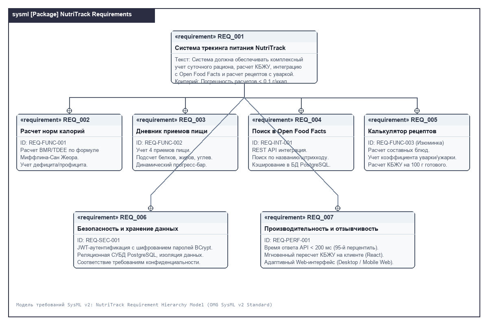
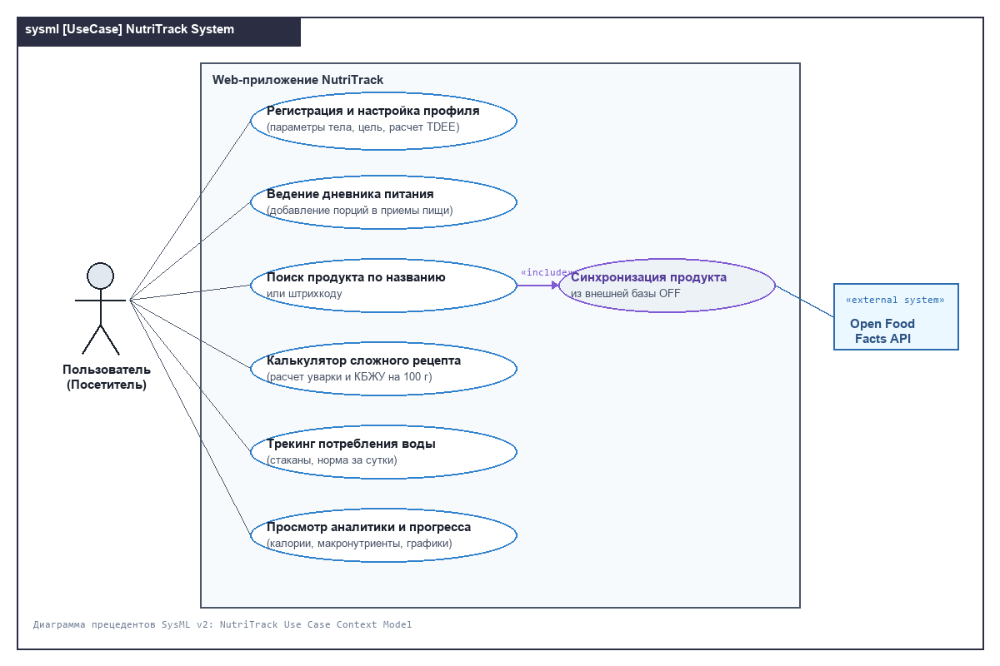
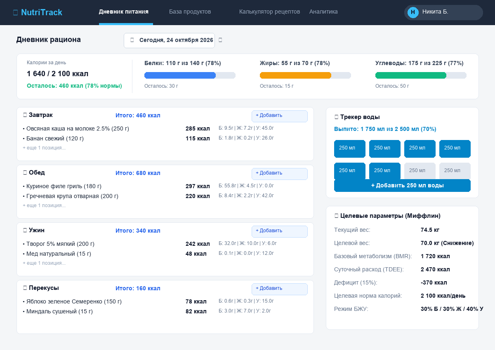
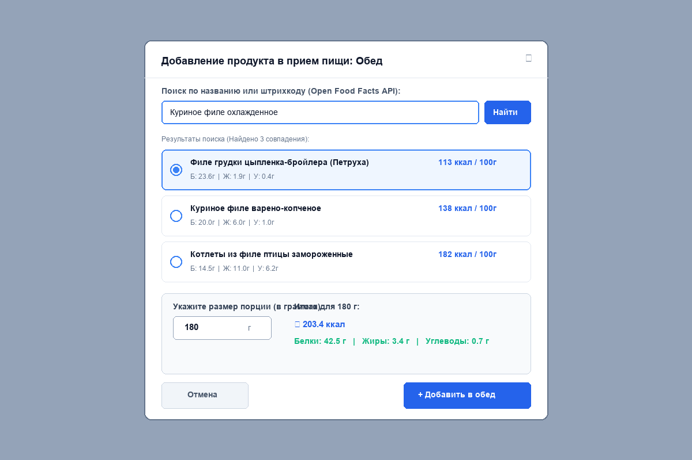
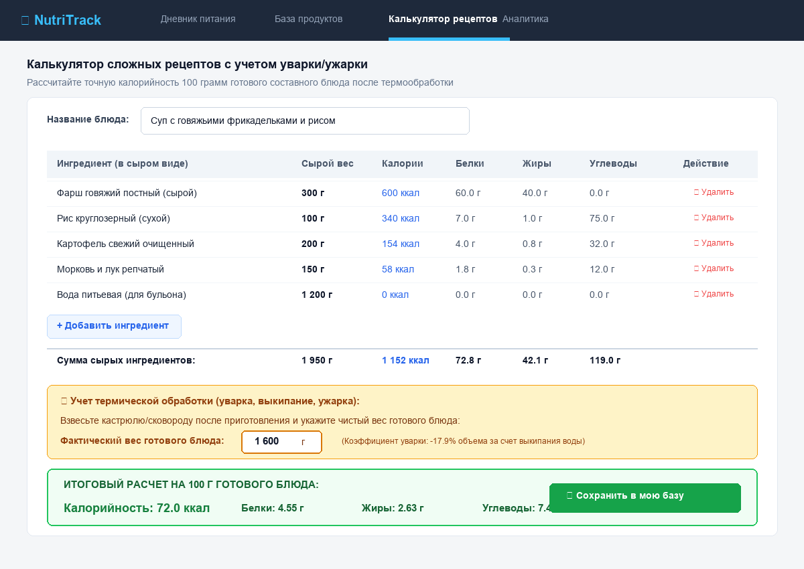

# Спецификация требований к ПО (SRS)

## Для программного комплекса «NutriTrack» (Трекер-калькулятор питания)

**Версия:** 1.0  
**Статус:** Согласовано  
**Автор:** Буринский Н.А. (студент гр. 450504)  
**Организация:** БГУИР, Факультет компьютерных систем и сетей, Кафедра ЭВМ  
**Дата изменения:** 24.10.2026  

---

## История изменений

| Редакция | Дата | Причина изменений | Версия | Автор |
| :--- | :--- | :--- | :--- | :--- |
| Инициализация | 23.10.2026 | Создание первичной структуры требований по результатам интервью с Заказчиком | 0.1 | Буринский Н.А. |
| SysML v2 Моделирование | 24.10.2026 | Разработка графических мокапов GUI и SysML v2 моделей требований | 0.2 | Буринский Н.А. |
| Ревью бизнес-сообщества | 24.10.2026 | Отработка замечаний из Pull Request: добавление виджета гидробаланса и калькулятора уварки | 1.0 | Буринский Н.А. |

---

## Содержание

* [1. Введение](#1-введение)
  * [1.1 Назначение документа](#11-назначение-документа)
  * [1.2 Область применения продукта](#12-область-применения-продукта)
  * [1.3 Определения, акронимы и сокращения](#13-определения-акронимы-и-сокращения)
  * [1.4 Ссылки](#14-ссылки)
  * [1.5 Обзор документа](#15-обзор-документа)
* [2. Обзор продукта](#2-обзор-продукта)
  * [2.1 Перспектива продукта](#21-перспектива-продукта)
  * [2.2 Функции продукта](#22-функции-продукта)
  * [2.3 Ограничения продукта](#23-ограничения-продукта)
  * [2.4 Характеристики пользователей](#24-характеристики-пользователей)
  * [2.5 Допущения и зависимости](#25-допущения-и-зависимости)
  * [2.6 Распределение требований](#26-распределение-требований)
* [3. Требования](#3-требования)
  * [3.1 Внешние интерфейсы](#31-внешние-интерфейсы)
    * [3.1.1 Пользовательские интерфейсы и мокапы GUI](#311-пользовательские-интерфейсы-и-мокапы-gui)
    * [3.1.2 Аппаратные интерфейсы](#312-аппаратные-интерфейсы)
    * [3.1.3 Программные интерфейсы (API)](#313-программные-интерфейсы-api)
  * [3.2 Функциональные требования](#32-функциональные-требования)
  * [3.3 Качество обслуживания (QoS)](#33-качество-обслуживания-qos)
    * [3.3.1 Производительность](#331-производительность)
    * [3.3.2 Безопасность](#332-безопасность)
    * [3.3.3 Надёжность](#333-надёжность)
    * [3.3.4 Доступность](#334-доступность)
  * [3.4 Соответствие стандартам](#34-соответствие-стандартам)
  * [3.5 Проектирование и реализация](#35-проектирование-и-реализация)
* [4. Верификация](#4-верификация)
* [5. Приложения](#5-приложения)

---

## 1. Введение

### 1.1 Назначение документа
Данная Спецификация требований к программному обеспечению (SRS) определяет функциональные и нефункциональные требования к кроссплатформенному веб-приложению «NutriTrack». Документ регламентирует объем системы, архитектурные ограничения, форматы взаимодействия с внешними сервисами и критерии приемки. Документ предназначен для команды разработчиков, специалистов по тестированию, системных архитекторов и Заказчика на всех фазах жизненного цикла разработки ПО.

### 1.2 Область применения продукта
«NutriTrack» — специализированный веб-ориентированный трекер-калькулятор питания, позволяющий пользователям:
1. Автоматически рассчитывать суточную норму калорий и макронутриентов (белки, жиры, углеводы) по научно верифицированной формуле Миффлина — Сан Жеора с учетом индивидуальных физических параметров и двигательной активности.
2. Вести ежедневный журнал приемов пищи (Завтрак, Обед, Ужин, Перекусы) с мгновенной визуализацией баланса нутриентов.
3. Интегрироваться с международной базой продуктов Open Food Facts через REST API для быстрого поиска блюд по наименованию и штрихкоду.
4. **Бизнес-изюминка**: производить точный расчет сложных составных кулинарных рецептов с учетом коэффициента уварки/ужарки (термической обработки) и рассчитывать чистую энергетическую ценность на 100 г готового блюда.

### 1.3 Определения, акронимы и сокращения

| Термин | Определение |
| :--- | :--- |
| **BMR** | Basal Metabolic Rate (Базовый уровень метаболизма) — минимальное количество энергии, необходимое организму в состоянии полного покоя. |
| **TDEE** | Total Daily Energy Expenditure (Суточный расход энергии) — фактический расход калорий с учетом коэффициента физической активности (PAL). |
| **КБЖУ** | Калории, Белки, Жиры, Углеводы — базовые макроэлементы суточного рациона. |
| **Open Food Facts** | Открытая краудсорсинговая глобальная база данных пищевых продуктов с нутриентным составом и штрихкодами. |
| **Уварка / Ужарка** | Изменение массы продукта в процессе термической кулинарной обработки за счет испарения воды или вытапливания жира. |
| **SysML v2** | Systems Modeling Language version 2 (OMG) — язык системного моделирования следующего поколения с текстовым и графическим синтаксисом. |
| **SPA** | Single Page Application — веб-приложение, загружающее единственную HTML-страницу и динамически обновляющее контент без перезагрузки. |

### 1.4 Ссылки
1. ISO/IEC/IEEE 29148:2018 — Systems and software engineering — Life cycle processes — Requirements engineering.
2. СТП 01-2017 «Общие требования к оформлению студенческих работ», БГУИР.
3. OMG Systems Modeling Language (OMG SysML™) v2 Specification.
4. Open Food Facts JSON API Documentation (v2).

### 1.5 Обзор документа
Раздел 2 погружает в концептуальное описание системы, роли пользователей и системные ограничения. Раздел 3 содержит формализованные требования с уникальными идентификаторами `REQ-*`, архитектурные мокапы GUI и интерфейсы. Раздел 4 содержит матрицу верификации требований, а Раздел 5 — исходные листинги SysML v2.

---

## 2. Обзор продукта

### 2.1 Перспектива продукта
Приложение «NutriTrack» является независимым веб-сервисом, развертываемым в контейнеризованной среде. Архитектура построена по клиент-серверной модели:
- Клиентская часть: адаптивное SPA на базе React + TypeScript (Vite).
- Серверная часть: RESTful Web API на базе платформы C# / ASP.NET Core (.NET 8/9).
- СУБД: реляционная база данных PostgreSQL.
- Внешняя экосистема: интеграция по протоколу HTTPS с Open Food Facts API для автодополнения каталога продуктов.

### 2.2 Функции продукта
1. **Профиль и персональный калькулятор:** расчет целевого суточного калоража с режимами дефицита (-15%), поддержания и профицита (+15%).
2. **Интерактивный дневник:** группировка по приемам пищи, оперативное редактирование граммовок, автосумма.
3. **Глобальный поиск продуктов:** поиск по текстовым запросам и штрихкодам через API Open Food Facts с кэшированием в PostgreSQL.
4. **Калькулятор термической обработки (Изюминка):** составление рецепта из N сырых ингредиентов, ввод массы готового блюда и расчет КБЖУ на 100 г готового продукта.
5. **Трекер гидратации:** фиксация выпитой воды с наглядным представлением стаканов.
6. **Аналитическая панель:** сводная статистика за день и неделю с отображением процента выполнения плана.

### 2.3 Ограничения продукта
- **CON-01 (Стек):** Серверный компонент должен быть реализован на языке C# с использованием фреймворка ASP.NET Core.
- **CON-02 (СУБД):** Хранение данных должно осуществляться в СУБД PostgreSQL с использованием миграций Entity Framework Core.
- **CON-03 (Клиент):** Интерфейс пользователя должен корректно отображаться в современных браузерах (Chromium, Gecko, WebKit) при разрешениях от 375px (смартфон) до 1920px (десктоп).
- **CON-04 (Автономность):** При недоступности внешнего сервиса Open Food Facts приложение должно сохранять работоспособность на локальной базе данных.

### 2.4 Характеристики пользователей

| Группа пользователей | Техническая грамотность | Частота использования | Ключевая цель |
| :--- | :--- | :--- | :--- |
| **Обычный пользователь** | Базовая (пользователь смартфона/ПК) | Ежедневно (3–5 раз в день) | Быстрый ввод съеденных блюд, контроль дефицита калорий |
| **Кулинар / Спортсмен** | Средняя | 2–4 раза в неделю | Расчет сложных авторских блюд с учетом уварки, точный баланс белков |
| **Администратор системы** | Высокая | По необходимости | Мониторинг работоспособности, управление справочниками |

### 2.5 Допущения и зависимости
- Пользователь имеет стабильное интернет-подключение (хотя бы 3G/LTE/Wi-Fi) для обмена данными с API.
- Внешний сервис Open Food Facts гарантирует доступность API не ниже 99% времени.

### 2.6 Распределение требований
- **Релиз 1.0 (Текущая цель курса ЖЦРПО):** Реализация аутентификации, базового калькулятора Миффлина, дневника питания, интеграции с Open Food Facts и калькулятора рецептов.
- **Релиз 2.0 (Перспектива):** Генерация списков покупок, интеграция со смарт-весами по Bluetooth, мобильное приложение на .NET MAUI.

---

## 3. Требования

### 3.1 Внешние интерфейсы

#### 3.1.1 Пользовательские интерфейсы и мокапы GUI
Пользовательский интерфейс спроектирован в стиле минималистичного карточного дашборда с акцентной цветовой индикацией нутриентов (Синий — белки, Желтый — жиры, Зеленый — углеводы).

Графическая часть спецификации требований разработана в соответствии с нотацией SysML v2:

##### 1. Диаграмма иерархии требований (SysML v2 Requirement Diagram)
Диаграмма отражает декомпозицию системных требований и связи между ними.

##### 2. Диаграмма вариантов использования (SysML v2 Use Case Diagram)
Диаграмма отражает взаимодействие Пользователя и внешнего API Open Food Facts с функциональными модулями системы.

##### 3. Мокап Главного экрана (Дашборд дневника питания)
Экран содержит сводку калорий, прогресс-бары макронутриентов, карточки 4 приемов пищи, виджет воды и блок целевых настроек.

##### 4. Мокап Модального окна добавления продукта
Окно обеспечивает поиск по базе Open Food Facts в реальном времени, выбор продукта, ввод веса и мгновенный предпросмотр КБЖУ порции.

##### 5. Мокап Калькулятора сложных рецептов с уваркой (Бизнес-изюминка)
Позволяет составить список ингредиентов в сыром виде, зафиксировать фактический вес готового блюда и получить точный расчет КБЖУ на 100 г готового продукта.

#### 3.1.2 Аппаратные интерфейсы
Прямые аппаратные интерфейсы отсутствуют. Система функционирует поверх сетевого протокола TCP/IP.

#### 3.1.3 Программные интерфейсы (API)
1. **Open Food Facts API v2:**
   - URL: `https://world.openfoodfacts.org/api/v2/product/{barcode}.json`
   - URL поиска: `https://world.openfoodfacts.org/cgi/search.pl?search_terms={query}&json=1`
   - Протокол: HTTPS / JSON.
2. **Внутренний NutriTrack REST API:**
   - Эндпоинты `/api/auth/*` — аутентификация и регистрация (JWT).
   - Эндпоинты `/api/profile/*` — параметры тела, цели, расчет TDEE.
   - Эндпоинты `/api/diary/*` — CRUD операции над записями дневника.
   - Эндпоинты `/api/recipes/*` — калькулятор блюд и сохранение авторских рецептов.

---

### 3.2 Функциональные требования

#### REQ-FUNC-001: Расчет суточной нормы калорий и БЖУ
- **ID:** REQ-FUNC-001
- **Title:** Автоматический расчет суточных потребностей организма
- **Statement:** Система должна рассчитывать величину базового обмена веществ (BMR) по формуле Миффлина — Сан Жеора:
  - Для мужчин: $BMR = 10 \times \text{вес (кг)} + 6.25 \times \text{рост (см)} - 5 \times \text{возраст (лет)} + 5$
  - Для женщин: $BMR = 10 \times \text{вес (кг)} + 6.25 \times \text{рост (см)} - 5 \times \text{возраст (лет)} - 161$  
  Итоговый суточный расход ($TDEE$) вычисляется умножением $BMR$ на коэффициент физической активности ($PAL \in [1.2, 1.9]$). В зависимости от выбранной цели (снижение веса, поддержание, набор массы) система должна устанавливать дефицит -15% или профицит +15%.
- **Rationale:** Обеспечение научно обоснованной базы для контроля массы тела пользователя.
- **Acceptance Criteria:** При вводе параметров (М, 75 кг, 180 см, 20 лет, умеренная активность $1.55$, дефицит 15%) система рассчитывает $TDEE = 2750$ ккал и целевую норму $2338 \pm 1$ ккал.
- **Verification Method:** Test (автоматизированные модульные тесты).

#### REQ-FUNC-002: Ведение суточного дневника приемов пищи
- **ID:** REQ-FUNC-002
- **Title:** Журнал суточного рациона с разбивкой по приемам пищи
- **Statement:** Система должна позволять пользователю добавлять, редактировать и удалять записи о съеденных продуктах в рамках категорий «Завтрак», «Обед», «Ужин» и «Перекус». Для каждой позиции пользователь указывает граммовку, после чего система пересчитывает КБЖУ пропорционально весу.
- **Rationale:** Ключевая базовая ценность приложения — прозрачный учет рациона.
- **Acceptance Criteria:** Изменение веса блюда на клиенте приводит к моментальному пересчету суммарных калорий без перезагрузки веб-страницы.
- **Verification Method:** Demonstration, Test.

#### REQ-FUNC-003: Калькулятор сложных составных блюд с учетом уварки/ужарки (Бизнес-изюминка)
- **ID:** REQ-FUNC-003
- **Title:** Расчет энергетической ценности готовых блюд с термообработкой
- **Statement:** Система должна предоставлять калькулятор рецептов, принимающий список ингредиентов в сыром виде с их массами ($m_{сыр, i}$) и калорийностью ($K_{сыр, i}$), а также итоговую фактическую массу готового блюда ($M_{гот}$) после варки/жарки. Итоговая калорийность 100 г готового блюда вычисляется по формуле:
$$K_{100г} = \frac{\sum_{i=1}^n K_{сыр, i}}{M_{гот}} \times 100$$
Аналогично вычисляется содержание белков, жиров и углеводов на 100 г.
- **Rationale:** В процессе кулинарной обработки вода выкипает (или впитывается), из-за чего калорийность на 100 грамм готового супа, каши или мяса кардинально отличается от сырых продуктов.
- **Acceptance Criteria:** При сложении 300 г говядины (600 ккал) и 100 г риса (340 ккал) с добавлением 1200 г воды (общий сырой вес 1600 г, 940 ккал), если готовый суп после выкипания весит 1400 г, калорийность на 100 г должна составить точно $67.14$ ккал.
- **Verification Method:** Test, Analysis.

#### REQ-FUNC-004: Интеграция с базой продуктов Open Food Facts
- **ID:** REQ-FUNC-004
- **Title:** Поиск продуктов по внешней открытой базе
- **Statement:** При поиске продукта система должна в первую очередь опрашивать локальную базу данных PostgreSQL, а при отсутствии совпадений — отправлять запрос к Open Food Facts API. Найденные продукты кэшируются в локальной БД.
- **Rationale:** Экономия времени пользователя на ручной ввод калорийности и состава покупных продуктов.
- **Acceptance Criteria:** При вводе названия продукта отображается выпадающий список вариантов с указанием бренда, калорийности и БЖУ на 100 г.
- **Verification Method:** Test, Inspection.

#### REQ-FUNC-005: Учет суточного потребления воды
- **ID:** REQ-FUNC-005
- **Title:** Трекер гидробаланса
- **Statement:** Система должна рассчитывать индивидуальную норму воды (30 мл на 1 кг массы тела) и предоставлять интерфейс быстрого добавления выпитой воды (шаг 250 мл) с графическим отображением шкалы прогресса.
- **Rationale:** Поддержание водного баланса критически важно для метаболизма.
- **Acceptance Criteria:** Нажатие на кнопку «+250 мл» мгновенно увеличивает счетчик выпитой воды и обновляет процент выполнения нормы.
- **Verification Method:** Demonstration.

---

### 3.3 Качество обслуживания (QoS)

#### 3.3.1 Производительность
- **REQ-PERF-001:** Серверный API должен возвращать ответ на запросы поиска продуктов и добавления записей дневника не более чем за 200 мс для 95% обращений при нагрузке до 50 одновременных пользователей.
- **REQ-PERF-002:** Время первой отрисовки страницы (FCP) веб-клиента в браузере не должно превышать 1.2 с на стандартном 4G/Wi-Fi соединении.

#### 3.3.2 Безопасность
- **REQ-SEC-001:** Все пароли пользователей должны храниться в базе данных исключительно в виде хэшей, сформированных с использованием алгоритма BCrypt (work factor не менее 11).
- **REQ-SEC-002:** Передача всех данных между браузером и сервером должна осуществляться исключительно по защищенному протоколу TLS (HTTPS).
- **REQ-SEC-003:** Сессионная аутентификация должна реализовываться с помощью токенов доступа JWT (JSON Web Token) со сроком жизни не более 60 минут и безопасных Refresh Tokens.

#### 3.3.3 Надёжность
- **REQ-REL-001:** Вероятность безотказной работы сервера приложения должна составлять не менее 99.5% в течение учебного семестра.
- **REQ-REL-002:** При сбое сетевого подключения к Open Food Facts клиент должен получать информативное сообщение с предложением ввести данные вручную без падения приложения.

#### 3.3.4 Доступность
- **REQ-AVAIL-001:** Доступ к приложению должен обеспечиваться круглосуточно (24/7) с перерывами на регламентное техническое обслуживание не более 2 часов в месяц.

---

### 3.4 Соответствие стандартам
- Оформление проектных материалов и отчетов должно строго соответствовать действующему СТП 01-2017 БГУИР.
- Текстовые и графические модели требований должны соответствовать спецификации OMG SysML v2.

---

### 3.5 Проектирование и реализация

#### 3.5.1 Технологический стек
- **Backend:** C#, .NET 8 / ASP.NET Core Web API, Entity Framework Core.
- **Frontend:** TypeScript, React 18+, Vite, Tailwind CSS / Shadcn UI.
- **База данных:** PostgreSQL 16+.
- **Инструментарий моделирования:** SysML v2, Markdown, Git / GitHub.

#### 3.5.2 Управление изменениями и ролевая игра («Заказчик — Менеджер»)
Разработка спецификации ведется по принципам ролевой игры:
1. Заказчик формулирует бизнес-потребности (учет калорий, точность данных, калькулятор готовых блюд).
2. Менеджер проекта формирует SRS и коммитит его в отдельную ветку репозитория.
3. В рамках механизма Pull Request напарник (Заказчик) и преподаватель вносят конструктивные замечания.
4. Конструктивные замечания (например, добавление трекера воды и разграничение уварки) интегрируются в SRS, а неконструктивные отклоняются с аргументированным техническим обоснованием.

---

## 4. Верификация

| ID требования | Метод верификации | Артефакт проверки | Критерий успешности |
| :--- | :--- | :--- | :--- |
| **REQ-FUNC-001** | Test (Unit-тесты) | `tests/BmrCalculatorTests.cs` | Погрешность расчета TDEE < 0.1% |
| **REQ-FUNC-002** | Test / Demo | `tests/DiaryServiceTests.cs` | Корректное суммирование 10 записей КБЖУ |
| **REQ-FUNC-003** | Test (Unit-тесты) | `tests/RecipeCookLossTests.cs` | Корректный расчет 100 г готового блюда с учетом уварки |
| **REQ-FUNC-004** | Test (Интеграционный) | `tests/OpenFoodFactsApiTests.cs` | Успешное получение нутриентов по штрихкоду |
| **REQ-FUNC-005** | Demonstration | Ручное тестирование UI | Визуальное обновление счетчика воды |
| **REQ-PERF-001** | Analysis (Нагрузочное) | `benchmarks/api_benchmark.json` | Время ответа 95-го перцентиля < 200 мс |
| **REQ-SEC-001** | Inspection | Код `Services/AuthService.cs` | Использование BCrypt, соль уникальна |

---

## 5. Приложения

### Приложение А: Исходные спецификации на языке SysML v2
- Исходный код пакета требований: `sysml/nutritrack_requirements.sysml`
- Исходный код пакета вариантов использования: `sysml/nutritrack_usecases.sysml`
- Исходный код спецификации GUI мокапов: `sysml/nutritrack_gui_mockups.sysml`

### Приложение Б: Графические артефакты
- Диаграмма требований: `images/sysml_requirements_diagram.png`
- Диаграмма вариантов использования: `images/sysml_usecase_diagram.png`
- Мокап дашборда: `images/mockup_main_dashboard.png`
- Мокап добавления продукта: `images/mockup_add_food_dialog.png`
- Мокап калькулятора рецептов: `images/mockup_recipe_calculator.png`
